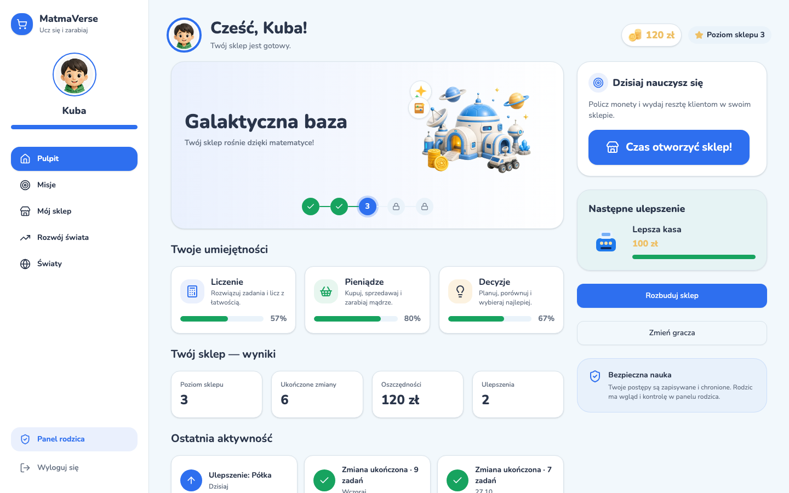
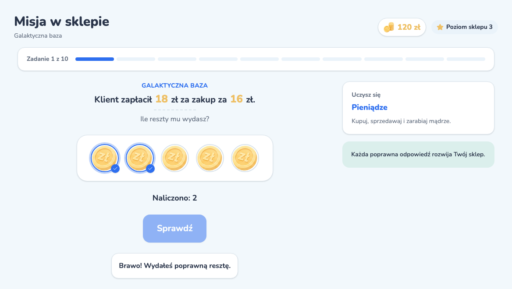
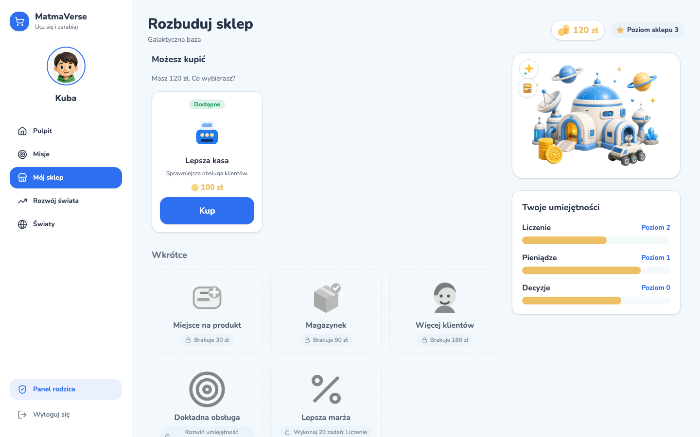
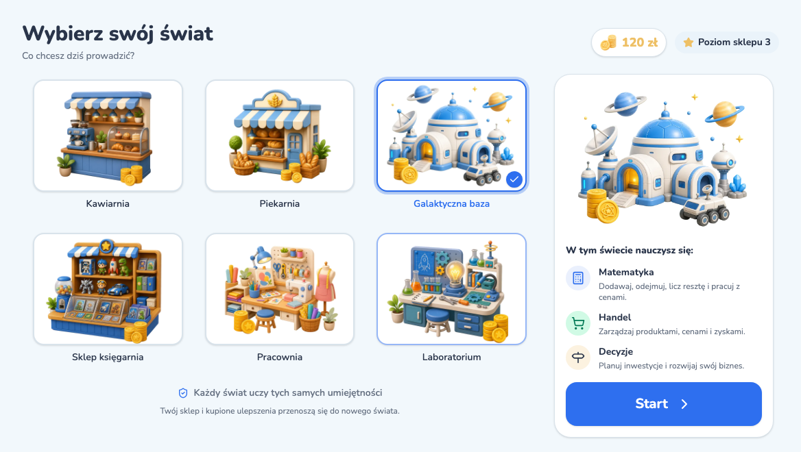
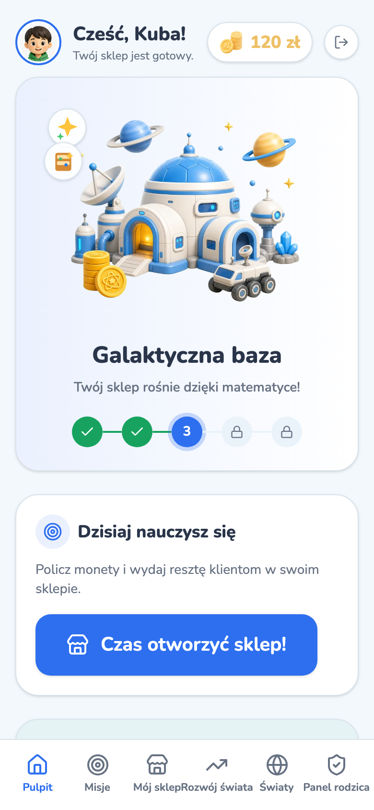
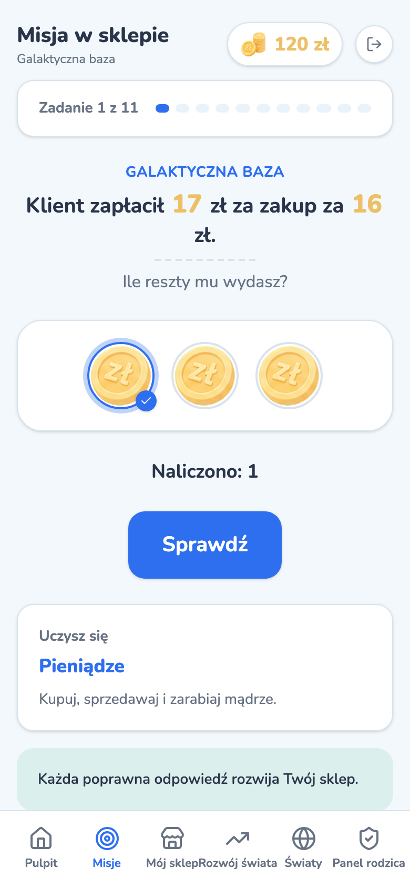
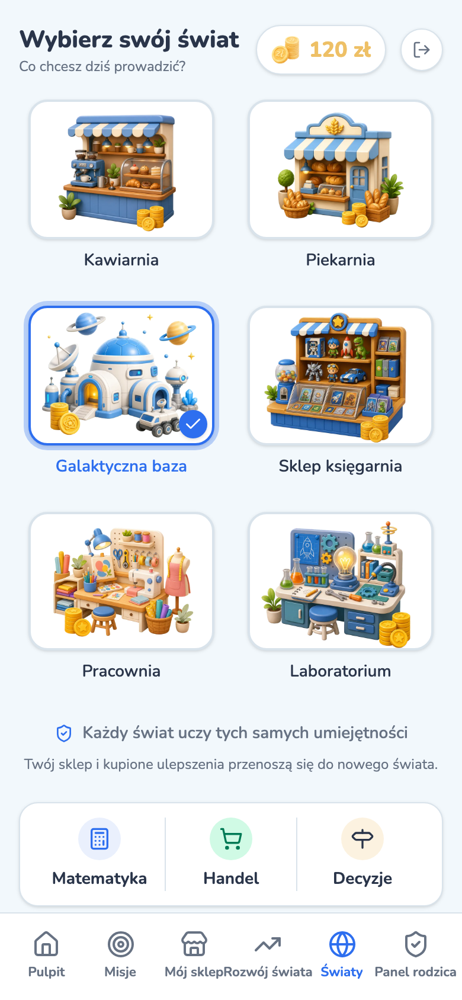
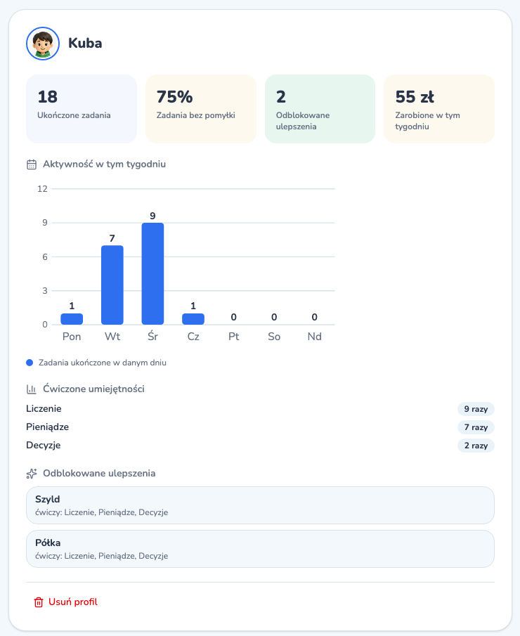

<div align="center">


# MatmaVerse

### Matematyka, która dzieje się w sklepie

Dziecko prowadzi własny biznes: obsługuje klientów, liczy monety, wydaje resztę<br>
i samo decyduje, za co rozbudować sklep. Rachunki przestają być zadaniem z zeszytu.

**[Zagraj za darmo →](https://matmaverse.ariom.cloud)** · [Jak to działa](#jak-to-działa) · [Dla rodzica](#dla-rodzica) · [Dla deweloperów](#dla-deweloperów)

<br>


</div>

---

## Po co liczyć, skoro nic z tego nie wynika?

Siedmiolatek przy biurku, przed nim „18 − 16 = ?”. Zna odpowiedź, ale nie widzi powodu, żeby ją podawać. To tylko kolejne działanie w kolejnym słupku.

Ten sam siedmiolatek za ladą własnej kawiarni wygląda zupełnie inaczej. Klient płaci 18 zł za zakup za 16 zł i czeka na resztę. Tu odpowiedź ma znaczenie: od niej zależy zadowolony klient, a zarobek idzie na nową półkę w sklepie.

**W MatmaVerse matematyka nigdy nie jest gołym działaniem.** Zawsze jest momentem w biznesie, który dziecko samo prowadzi i rozwija.

<table>
<tr>
<td width="33%" valign="top">

### 🪙 Prawdziwe pieniądze w grze

Dziecko liczy monety w kasie i wydaje resztę klientom. Kwoty są dopasowane do wieku 6–9 lat, a monety się dotyka i odlicza, zamiast tylko wpisywać liczby.

</td>
<td width="33%" valign="top">

### 🏪 Sklep, który rośnie

Za zarobione złotówki dziecko kupuje ulepszenia: szyld, półkę, lepszą kasę. Każdy zakup to decyzja: co teraz, a na co odłożyć?

</td>
<td width="33%" valign="top">

### 🌍 Świat, który ciekawi

Kawiarnia, piekarnia, galaktyczna baza, księgarnia, pracownia albo laboratorium. Każdy świat uczy tych samych umiejętności, zmienia się tylko to, co dziecko lubi.

</td>
</tr>
</table>

## Twój sklep, twój świat

Po zalogowaniu dziecko widzi swój świat, zarobione złotówki i poziom sklepu. Trzy paski pokazują, jak rosną jego umiejętności: **liczenie**, **pieniądze** i **decyzje**. Jeden przycisk otwiera sklep i zaczyna kolejną zmianę.

<p align="center">
  
</p>

## Przykład: klient czeka na resztę

Zmiana to kilka krótkich misji przy ladzie. Tutaj klient zapłacił **18 zł** za zakup za **16 zł**. Dziecko dotyka monety, które chce oddać, a licznik pod spodem pokazuje, ile już odliczyło. Po kliknięciu „Sprawdź” od razu wie, czy klient wychodzi zadowolony.

<p align="center">
  
</p>

Pomyłka nie kończy gry i nie zabiera monet. Dziecko próbuje jeszcze raz, a po jednej lub dwóch pomyłkach dostaje wskazówkę, np. _„Policz od ceny w górę aż do zapłaconej kwoty”_. Błąd jest tu krokiem w nauce, nie karą.

## Zarobione, więc moje

Za zarobione złotówki dziecko rozbudowuje sklep. Widzi, co może kupić od razu i ile brakuje do kolejnych ulepszeń. To pierwsza lekcja planowania budżetu: lepsza kasa teraz czy magazynek za dwie zmiany?

<p align="center">
  
</p>

## Sześć światów do wyboru

Każde zainteresowanie może stać się sklepem. Świat można zmienić w każdej chwili: zarobione pieniądze i kupione ulepszenia przechodzą razem z dzieckiem.

<p align="center">
  
</p>

## Na telefonie i tablecie

Pełna wersja mobilna z dolną nawigacją. Rodzinny tablet na kanapie, telefon w poczekalni u lekarza: sklep jest zawsze pod ręką.

<p align="center">
  
  &nbsp;
  
  &nbsp;
  
</p>

## Dla rodzica

<table>
<tr>
<td width="55%" valign="top">

Konto zakłada rodzic. Dziecko gra na swoim profilu z awatarem, bez podawania danych, które by je identyfikowały.

**Panel rodzica** jest chroniony PIN-em, więc dziecko nie zmieni ustawień ani nie usunie profilu. W panelu jest **raport tygodniowy** dla każdego dziecka:

- ile zadań ukończyło i jaki procent bez pomyłki,
- w które dni grało,
- które umiejętności ćwiczyło i ile razy,
- jakie ulepszenia kupiło i czego uczył każdy zakup.

Bez rankingów, porównań z innymi dziećmi i presji. Rodzic dostaje spokojny obraz tego, czego dziecko się nauczyło.

</td>
<td width="45%" valign="top">



</td>
</tr>
</table>

## Jak to działa

1. **Rodzic zakłada konto** na [matmaverse.ariom.cloud](https://matmaverse.ariom.cloud) i potwierdza e-mail.
2. **Tworzy profil dziecka:** awatar, wiek i pierwszy świat. Poziom zadań dopasuje się sam.
3. **Dziecko otwiera sklep.** Jedna zmiana to kilka minut i kilka misji. Na koniec widzi, ile zarobiło, i może wydać pieniądze na rozbudowę.
4. **Rodzic zagląda do raportu**, kiedy chce, za PIN-em.

Poziom trudności rośnie razem z dzieckiem: liczby są większe, reszta trudniejsza, a decyzje zakupowe ciekawsze.

## Bezpieczeństwo i prywatność

- **Bez reklam i bez zakupów w aplikacji.** Złotówki w grze to wyłącznie waluta sklepu.
- **Dane każdej rodziny są odizolowane** na poziomie bazy (Row Level Security w Postgresie). Jedno konto nigdy nie zobaczy profili dzieci z innego.
- **Profil dziecka nie wymaga danych osobowych.** Wystarczą awatar, wiek i imię lub pseudonim.
- **Usunięcie konta usuwa wszystko:** profile dzieci, postępy i raporty.

## Zagraj

**https://matmaverse.ariom.cloud**: załóż konto rodzica, dodaj profil dziecka i otwórzcie pierwszy sklep. Za darmo.

---

## Dla deweloperów

**Stos:** [Astro 6](https://astro.build) (SSR, `@astrojs/node`) · React 19 · Tailwind 4 · shadcn/ui · [Supabase](https://supabase.com) (Postgres, Auth, RLS, self-hosted) · Docker + Caddy na VPS · Vitest · Playwright · GitHub Actions

Zasady pracy z repozytorium i architektura: [`CLAUDE.md`](CLAUDE.md). Produkt: [`context/foundation/prd-v3.md`](context/foundation/prd-v3.md). Wzorce izolacji danych: [`docs/reference/rls-isolation.md`](docs/reference/rls-isolation.md).

### Uruchomienie lokalne

Wymagania: Node.js 22 (`.nvmrc`), Docker Desktop (~7 GB RAM dla stosu Supabase).

```bash
git clone https://github.com/vince307/mathshop.git && cd mathshop
npm ci
npx supabase start          # Postgres, Auth i Mailpit w Dockerze
cp .env.example .env        # SUPABASE_URL i SUPABASE_KEY (anon) z `npx supabase status`
npm run db:reset            # migracje + seed z kontem testowym
npm run dev                 # http://localhost:4321
```

Seed tworzy konto `rodzic@mathshop.test` / `haslo123` (PIN rodzica `1234`) z dwójką dzieci: **Ola** (7 lat, Kawiarnia, pierwszy dzień) i **Kuba** (9 lat, Galaktyczna baza, 120 zł, poziom sklepu 3, tydzień historii). Seed zapisuje znane hasło wprost do `auth.users`, więc uruchamiaj go **tylko lokalnie**.

Lokalnie potwierdzanie e-maila jest wyłączone (`enable_confirmations = false`, testy na tym polegają). Maile z lokalnego stosu czyta się w Mailpit: http://localhost:54324.

### Komendy

| Komenda                                | Co robi                                                                          |
| -------------------------------------- | -------------------------------------------------------------------------------- |
| `npm run dev`                          | serwer deweloperski                                                              |
| `npm run build` / `npm start`          | build produkcyjny i jego uruchomienie (`node dist/server/entry.mjs`)             |
| `npm run lint` / `npm run format`      | ESLint z regułami opartymi na typach / Prettier                                  |
| `npm test`                             | Vitest: logika gry, API i izolacja RLS na lokalnym Supabase (wymaga `.env.test`) |
| `npm run test:e2e`                     | Playwright: pełne ścieżki w przeglądarce (`e2e/CLAUDE.md`)                       |
| `npm run db:reset` / `npm run db:seed` | baza od zera z migracjami / ponowne wgranie samego seeda                         |
| `docker build -t matmaverse:local .`   | obraz produkcyjny                                                                |

`.env.test` (z `.env.test.example`) bierze `API_URL`, `ANON_KEY` i `SERVICE_ROLE_KEY` z `npx supabase status -o env`, a do tego `PARENT_SESSION_SECRET`. Klucze lokalnego stosu to publiczne klucze demo, takie same na każdej maszynie. Nigdy nie używaj ich w żadnym wdrożonym środowisku.

### CI/CD

Każdy PR przechodzi `ci` (`astro check`, lint, build, Vitest na lokalnym Supabase, test originu za proxy) i `e2e` (Playwright). Merge do `main` uruchamia `deploy`: obraz `ghcr.io/vince307/matmaverse:<sha>`, migracje (najpierw `--dry-run`) i wdrożenie kontenera na VPS przez Tailscale (Caddy → `https://matmaverse.ariom.cloud`, health check `GET /api/health`, automatyczny powrót do poprzedniego obrazu, gdy ten nie przejdzie). Nie ma wdrożeń podglądowych. Szczegóły: [`context/foundation/infrastructure.md`](context/foundation/infrastructure.md).

Produkcyjny Supabase (self-hosted, z potwierdzaniem e-maili i SMTP `hello@ariom.cloud`) jest skonfigurowany w osobnym repozytorium infrastruktury. Szablony maili wysyła aplikacja z `supabase/templates/`.

<details>
<summary><b>AI code review (wyłączone)</b></summary>

<br>

`packages/code-reviewer/` to agent, który ocenia diff według rubryki z [`context/team/code-review-dod.md`](context/team/code-review-dod.md) i zwraca werdykt w JSON. Lokalnie:

```bash
npm --prefix packages/code-reviewer ci
git diff main...HEAD | npx --prefix packages/code-reviewer tsx packages/code-reviewer/review.ts
```

Wymaga `ANTHROPIC_API_KEY` w `.env`. Kody wyjścia: `0` przeszło, `1` nie przeszło, `2` błąd konfiguracji lub budżetu (nigdy werdykt).

Bramka na PR-ach (`.github/workflows/review.yml`) jest **wyłączona** od 2026-10-29: workflow jest wyłączony w GitHubie, a `review` nie jest już wymaganym checkiem na `main`. Włączenie z powrotem:

```bash
gh workflow enable review.yml
gh api -X PATCH repos/vince307/mathshop/branches/main/protection/required_status_checks \
  -F strict=false -f 'contexts[]=ci' -f 'contexts[]=e2e' -f 'contexts[]=review'
```

</details>

<div align="center">
<br>

<br>
<sub>Matematyka · Ekonomia · Przyszłość</sub>
</div>
