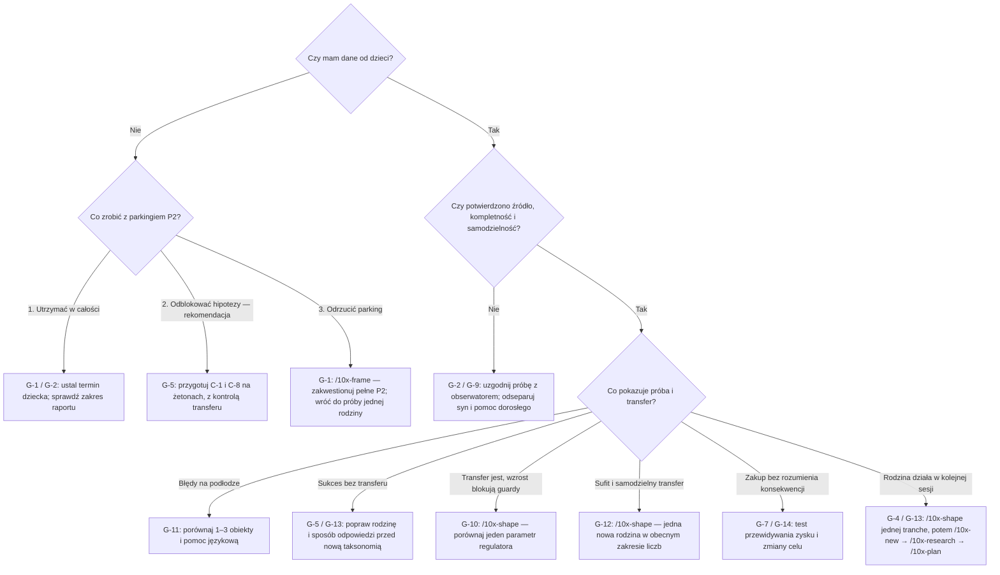

## TL;DR

1. **[V]** MathShop ma wspólną, deterministyczną logikę generowania i adaptacji oraz serwerowe przeliczanie wypłaty z posiadanych ulepszeń (`src/data/shift.ts:createShiftSource`, `src/data/adaptive.ts:foldShiftOutcomes`, `src/lib/services/child-profiles.ts:recordShiftResult`).
2. **[V]** Repertuar obejmuje dwa typy i trzy scenariusze; liczenie pozwala zaliczyć zadanie przez zaznaczenie wszystkich monet (`src/types.ts:Task`, `src/components/child/CountingTask.tsx:CountingTask`).
3. **[I]** Największą luką jest trafność pomiaru uczenia się: poprawne wykonanie gestów i zakup nie dowodzą rozumienia liczby, reszty ani wyboru ekonomicznego.
4. **[I; obserwacja: brak]** Obserwacji dzieci w materiale tej sesji jest **zero**; harness sprawdza przepływ i odpowiedź silnika na zadany model, nie dziecko (`scripts/telemetry-harness/README.md:What this does NOT prove`).
5. **[I]** Rekomenduję częściowo odblokować P2 wyłącznie do projektowania i walidacji hipotez, bez wdrażania trwałej taksonomii i migracji bramek — to jawne zawężenie decyzji o zaparkowaniu z 2026-08-26.
6. **[I]** Na razie zachować `d`, seedy, sufity i monotoniczne bramki; najpierw sprawdzić, co naprawdę oznacza `first_try`, a dopiero potem stroić tempo.
7. **[I]** Pętla ekonomii daje okazję do nauki, ale naukę trzeba wykazać przez przewidywanie, wybór i przeniesienie rozumowania na nową sytuację.
8. **[I]** Docelowy kierunek treści to autorowane rodziny zadań ze sprawdzanymi parametrami; LLM offline może dostarczać propozycje, nigdy odpowiedzi w runtime.
9. **[V]** Przed odczytem wyników dzieci trzeba przygotować ich jawny zakres: obecny `report.sql:SCOPE` wybiera tylko `syn-%`.
10. **[I]** Jedna rzecz w tym tygodniu: przygotować i przeprowadzić pierwszy pilotaż „aplikacja → ten sam sens na żetonach → nowa sytuacja”, według protokołu G-2 i kroków 1–3.

## Założenia

**[I]** Pięć pytań zadano po lekturze wymaganych źródeł; w chwili redakcji brak odpowiedzi, więc obowiązują poniższe domyślne. Są to założenia organizacyjne, nie ustalenia maintainera.

| Pytanie | Przyjęta odpowiedź | Co zmieni inna odpowiedź |
|---|---|---|
| Ile dzieci i spotkań jest dostępnych? | 3 dzieci: 6–7, 8 i 9 lat; każde dwa spotkania po 15–20 min w dwa tygodnie. | Jedno dziecko nadal pozwala wykryć konkretną porażkę, lecz nie porównać wieku; brak dzieci pozostawia badanie aparatury i recenzję nauczyciela, nie odblokowuje strojenia. |
| Czy LLM offline jest dopuszczalny? | Tak, opcjonalnie, po pełnej recenzji człowieka. | Zakaz usuwa opcję G-4(3), ale nie zmienia modelu katalogu ani generatorów. |
| Co oznacza ekonomia? | Pieniądze, zysk, świadomy wybór, koszt alternatywny, oszczędzanie i prosty jawny popyt. | Węższy cel obniża priorytet C-3/C-5/C-10; nadal trzeba odróżnić przychód od zysku. |
| Czy podstawa klas 1–3 jest wymaganiem? | Punkt odniesienia, bez obietnicy realizacji całego programu. | Wymóg formalny wymaga osobnego mapowania na obowiązującą podstawę i przeglądu nauczyciela przed akceptacją P2. |
| Czy wolno testować na papierze i żetonach obok aplikacji? | Tak, z dorosłym prowadzącym scenariusz. | Przy zakazie nowych prototypów pilotaż bada dwa typy i rozmowę po zakupie; nowy typ wymaga wcześniej osobnej małej tranche do aplikacji. |

**Konwencja dowodowa.** **[V]** oznacza fakt odczytany w tej sesji z kodu albo fakt, że dokument zawiera określoną decyzję; zapis `plik:symbol` wskazuje funkcję, stałą lub nagłówek, nigdy numer linii (`context/foundation/lessons.md:L-006`). **[I]** oznacza wniosek, hipotezę, rekomendację, przewidywany scenariusz lub założenie. Dla źródeł edukacyjnych spoza repo ich zastosowanie do MathShop pozostaje **[I]**, także gdy źródło jest podlinkowane. **Arytmetyka** obejmuje wyliczenia i symulacje na zadanych stałych; **obserwacja** oznacza zachowanie rzeczywistego dziecka. Analiza kontraktu kodu nie jest obserwacją dziecka; oznaczam ją jako „arytmetyka/analiza statyczna”.

**[I; obserwacja: brak]** „Zero obserwacji” określa bazę dowodową tego przeglądu, zgodnie z briefem. Nie wykonywano odczytu lokalnej ani produkcyjnej bazy i nie sprawdzano stanu wdrożenia. **[V]** Datowane wpisy o pustych tabelach i nieopublikowanej gałęzi są historyczne (`shape-notes-p2-curriculum.md:Why this is parked`); późniejszy backlog opisuje już 784 syntetyczne wiersze (`backlog.md:Parked pending telemetry`).

**[V] Korekty przesłanek wejściowych i źródeł:**

- `CLAUDE.md:Project` odsyła do v2, natomiast `prd-v3.md:MathShop — Product Requirements Document (v3, MathMarket re-baseline)` jawnie ją zastępuje. Tutaj rządzi v3; i18n to w niej FR-006/Guardrails, a FR-013 to następny zakup. Archiwalne FR-007 dotyczące granicy 20 nie jest dzisiejszym FR-007 wypłaty, ale granicę zachowuje jawna decyzja `adaptive-seed-vs-ceiling/change.md:Decyzja (2026-08-26, maintainer)`.
- Spec adaptacji lokuje `d` w `skill_state` i przewiduje `shift_log_id`; implementacja trzyma osobne `difficulty_state`, a tabela prób nie ma tego FK (`adaptive.ts:DifficultyState`, migracja `20260825120000_create_task_attempt.sql:create table public.task_attempt`). To świadome różnice, nie propozycje tego review.
- Pełny replay z seeda nie jest dzisiejszą autoryzacją wyniku (`complete.ts:completeSchema`, `child-profiles.ts:recordShiftResult`). Generator może odtworzyć przebieg przy tych samych wejściach; endpoint nie przyjmuje seeda ani planu.
- Wynik harnessa o suficie 0.5 dotyczy poziomu 1; solver nie obsługuje `stock_and_change` (`scripts/telemetry-harness/README.md:What this does NOT prove`). Nie mówi nic o dojściu dziewięciolatka do 1.
- Ekonomia ma D-13 oraz D-11 odwracającą zakaz dekoracji z D-4; obecne no-dominance jest słabsze niż pierwotne D-12 (`shape-notes-world-economy.md:D-11`, `D-12`, `D-13`; `tests/economy-invariants.test.ts:DOMINANCE_FLOOR`).
- Wzrost `decisions` dotyczy zakupu ulepszenia, nie dekoracji (`child-profiles.ts:buyUpgrade`, `buyDecoration`).
- Historyczny opis „pierwszy zakup w zmianie 1 łamie cel ~3 zmian” jest skorygowany w README: PRD mówi **w ciągu** pierwszych ~3 zmian (`prd-v3.md:Success Criteria`, `scripts/telemetry-harness/README.md:What the model says about the content run`). Nie rekomenduję ponownego „naprawiania” tej interpretacji.

## Stan obecny [V]

Wszystkie wiersze poniżej są **[V]**; dokumenty projektowe zapisują intencję lub dawny stan, a funkcje — aktualny mechanizm. Bez ocen skuteczności edukacyjnej.

| Źródło przeczytane w Kroku 0 | Co faktycznie stwierdza / ustala |
|---|---|
| `CLAUDE.md:Project`, `Conventions` | Działanie matematyczne ma cel w prowadzeniu sklepu; zakaz gołego równania; polska treść przygotowana do lokalizacji. |
| `prd-v3.md:Non-Goals`, `Open Questions` | Dwa filary: rozwój przez wybór i światy zainteresowań; formalna klasa 3 i pricing/inventory odroczone; taksonomia pozostawiona planowaniu (#4); rozumienie wydania oszczędności niepotwierdzone (#5). Kontrola trudności przez rodzica jest true non-goal. |
| `shape-notes-world-economy.md:Decisions taken` | D-1 marże za praktykę, D-2 ścieżka 10x bez nowego PRD, D-3 wspólna mechanika światów, D-4 rodzaje efektów, D-5 koszt przed wypłatą i brak straty portfela, D-6 koszt od zakupów, D-7 szyld otwiera marże, D-8 monotoniczne bramki, D-9 poziom co 3 zmiany, D-10 niewykluczające się gałęzie i 8 ulepszeń, D-11 dekoracje poza inwestycjami, D-12 balans, D-13 model tempa. D-6 zastępuje wcześniejsze uzależnienie kosztu od poziomu z D-5. |
| `shape-notes-p2-curriculum.md:Why this is parked` | P2 zatrzymana w fazie 1: brak danych dzieci, ryzyko projektowania taksonomii i migracji bramek z samych obliczeń; lokalna sesja jest dopuszczalnym źródłem danych. |
| `backlog.md:Parked pending telemetry`, `Needs shaping` | P2 nie jest Ready; B3 dzieli z nią brak katalogu modułów; B2 potrzebuje produktu i nowych zadań; B5 czeka na B2. |
| Spec adaptacji: `Ordering rationale`, `Design`, `Follow-on` | P1+P3 przed curriculum, dwuetapowa generacja SSR/klient, jeden zapis końcowy, wyniki służą foldowi; P4 w dekompozycji produktu oznacza narrację/LLM offline. |
| Spec ekonomii: `The profit rule`, `Gates`, `The pacing model` | Koszt od inwestycji, wypłata nieujemna, 8 ulepszeń plus dekoracje, bramki nieoparte na `d`, wspólne funkcje klient/serwer; model cen w zadaniach. |
| `lessons.md:L-001`…`L-009` | Izolacja i kontrola trwałego zapisu, i18n, falsyfikowalne sprawdziany, baseline+delta testów, symbole zamiast linii, ostrożne locatory i dane dla review, sprawdzanie właściwej ścieżki pomiarowej. |
| Archiwum adaptacji: `change.md:Notes`, `reviews/plan-review.md:F1`, `F3`, `F7` | Ustalono scalar, pominięcie `misses` w sterowaniu, lazy generation, pojedynczy POST, brak LLM runtime; dodano osobną kontrolę dopuszczenia scenariusza, literalny limit 17, null dla niezmierzonego `d`. |
| Archiwum seedów: `change.md:Decyzja (2026-08-26, maintainer)`, `What shipped` | Rozdzielono kotwice, seedy i sufity; zachowano sufity i istniejące profile, zmieniono tylko seed nowych/uszkodzonych stanów; nie zastępuje to P2. W tym archiwum nie znaleziono plików `reviews/`. |

**[V] Mapa wykonania:**

| Element | Dzisiejszy kontrakt i kotwica |
|---|---|
| Start | Wiek 6–7 → `starting_level=1`, 8 → 2, 9 → 3 (`leveling.ts:deriveStartingLevel`); `LEVEL_SEED={1:0,2:0.2,3:0.6}`; odczyt zapisanych wartości do sufitu 0.5/0.5/1 (`adaptive.ts:readDifficultyState`, `ceilingForLevel`). |
| Parametry | W `d=0/0.5/1`: liczenie 3–10 / 6–20 / 10–25; reszta do 5/10/15; zapłata do 10/20/30; bazowa zmiana 5–7 / 8–10 / 9–12 (`adaptive.ts:acrossTiers`, `countRangeFor`, `changeCapFor`, `paidMaxFor`, `shiftLengthRangeFor`). Interpolacja jest zaokrąglana do liczb całkowitych. |
| Typy i scenariusze | `counting → count_till`; `change_making → give_change` albo `stock_and_change` przy `d≥0.75` i losowaniu z prawdopodobieństwem 0.3. Dwuetapowy wariant ma stałe limity ceny 15 i reszty 10, nie dalszą interpolację (`change-making-tasks.ts:generateChangeMakingTask`, `generateStockAndChangeTask`). |
| Odpowiedź | Monety mają wartość 1 zł. Liczenie: zaznacz tyle, ile pokazano. Reszta: zaznacz właściwą liczbę spośród `change+1…3`; stage 1 odlicza cenę. Bieżąca liczba zaznaczonych jest podana; `check` porównuje liczebność (`src/types.ts:ChangeMakingTask`, `CountingTask.tsx:CountingTask`, `TaskScreen.tsx:TaskScreen`, `useCoinTask.ts:check`). |
| Adaptacja | `ADAPT_RATE=.05`, `TARGET_SUCCESS=.8`; +.01 za zadanie bez pomyłek lub −.04 za zadanie z co najmniej jedną, niezależnie od liczby pudeł. Warm-up to tylko indeks 0 całej zmiany; cooldown dotyczy zadania po błędzie dowolnej kompetencji; drift ±.15 per kompetencja od początku zmiany; końcowe zadanie generowane z ulgą .1 (`adaptive.ts:nextDifficulty`, `foldShiftOutcomes`, `relieveForFinalTask`). |
| Kompozycja | Prawdopodobieństwo liczenia od .35 do .65, na podstawie początkowej różnicy `d`; co najmniej jeden typ każdego rodzaju przy długości ≥2. To limit prawdopodobieństwa losowania, nie limit udziału w konkretnej zmianie. Długość bierze maksimum obu `d`, dodaje capacity do +5 i ogranicza do 17 (`tasks.ts:typeSplitFor`, `shift.ts:drawTypes`, `lengthDifficulty`, `planShift`, `upgrades.ts:MAX_BONUS_TASKS`). |
| Przebieg | `openShift` tworzy plan i task 1; `useShiftEngine` odtwarza strumień PRNG, generuje pozostałe zadania po wynikach; `drawDifficultyFor` stosuje fold i ulgę końcową. Zmiana ma stałą długość. |
| Scoring | 3 gwiazdki tylko za 100% clean, 2 od 70%, 1 od 40%; podpowiedź po 2 błędnych zatwierdzeniach; dwie fazy scalają firstTry przez AND, błędy i czas przez sumę (`shift.ts:starsForShift`, `src/types.ts:RETRY_HINT_THRESHOLD`, `ChangeMakingTask.tsx:StockAndChangeTask`). |
| Postęp | `math` od counting, `money` od change-making; progi `[3,8,15,25,40]` liczą skumulowane firstTry. `decisions` dostaje +1 completed i +1 firstTry przy `buyUpgrade`; `firstTryPercent` wyklucza `decisions`; `buyDecoration` nie dodaje tego punktu (`skills.ts:COMPETENCIES`, `skillLevel`, `firstTryPercent`; `child-profiles.ts:buyUpgrade`, `buyDecoration`). |
| Ekonomia | `profitForShift` zaokrągla jednostkowe stawki i odejmuje runningCost, z podłogą 0. `precision`: 3→5 zł za clean, koszt zmiany +3; `margin`: 5→7 zł za task, koszt +3. Każda z pięciu capacity: task +1, koszt +2. `sign`: efekt bezpośredni 0, koszt bieżący 0, otwiera marże (`shift.ts:profitForShift`, `upgrades.ts:UPGRADES`, `shopEffects`). |
| Zakupy i światy | 8 wspólnych ulepszeń; cztery mają bramkę skill/history. 6 światów; po 4 jednorazowe dekoracje o cenach 40/80/140/220, poza `purchased`. `nextPurchase` najpierw wybiera upgrade według poziomu i ceny, potem dekorację aktualnego świata (`upgrades.ts:canBuy`, `nextUpgrade`, `worlds.ts:WORLDS`, `decorations.ts:DECORATIONS`, `nextPurchase`). |
| Poziomy | `businessLevelForShifts(n)=1+floor(n/3)`, bez limitu; cztery etapy od poziomów 1/2/3/4, ostatni bez nowych ulepszeń wymagających tego poziomu (`shift.ts:businessLevelForShifts`, `stages.ts:STAGES`, `unlocksForStage`). |
| Autoryzacja | SSR endpoint, auth, RLS-objęty odczyt profilu, zod i uzgodnienie liczby prób/clean/indeksów/kompetencji; wypłata i `d` obliczane na serwerze. `skills` ma ograniczenia sum przez `≤`, nie dokładną równość z próbami; scenariusz i parametry nie są porównywane z wygenerowanym zadaniem (`complete.ts:completeSchema`, `POST`; `child-profiles.ts:recordShiftResult`). |
| Telemetria | Próba zapisuje typ, scenariusz, kompetencję, `d`, parametry, firstTry, misses, czas i indeks. Zapis przy zakończeniu, best-effort; brak `shift_id`, seeda, wersji generatora, osobnych etapów, podpowiedzi i odpowiedzi błędnej (`attempts.ts:TaskAttempt`, `attemptParams`; `child-profiles.ts:appendTaskAttempts`; migracja `create table public.task_attempt`). |
| Pozostałe `src/data/` | `activity.ts:toActivityEntry` klasyfikuje historię zmian i zakupów, nie steruje nauką; `avatars.ts:AVATARS` oraz `marketing-art.ts:MARKETING_ART` opisują zasoby i tożsamość, nie generowanie ani poziom zadań. |

## Diagnoza

### A. Adaptacja: sterownik parametrów, nie model wiedzy

**Najsilniejszy argument przeciw zmianie [I]:** prosty i jawny regulator może wystarczać przy dwóch rodzinach zadań; BKT z parametrami zgadniętymi zamiast zmierzonych doda pozorną precyzję. Najsilniejszy argument przeciw pozostawieniu wszystkiego [I]: jeśli `first_try` mierzy sprawność zaznaczania, regulator będzie doskonalił dobór złego zadania niezależnie od parametrów.

- **A1 [V; arytmetyka].** Bez guardów oczekiwany krok wynosi `0.01p − 0.04(1−p)`, więc jest zerowy przy p=.8 (`adaptive.ts:nextDifficulty`). **[I; arytmetyka modelowa]** Przy niezależnych kolejnych wynikach o takim samym p, bez granic i warm-up, cooldown zmienia go na `0.01p² − 0.04(1−p)`: równowaga to około **.8284**, nie .8. Ogólniej dodatni krok zależy też od poprawności poprzedniego typu; pomyłki w money hamują wzrost math. To wyprowadzenie, nie estymata rzeczywistej równowagi aplikacji: typy, trudność, długość i wyniki są zależne, a końcowa ulga dodatkowo zmienia ekspozycję. Twierdzenie w komentarzu „zbiega do .8” nie dowodzi zachowania pełnego układu.
- **A2 [V; arytmetyka/symulacja historyczna].** Backlog raportuje maksimum około .29 po 20 zmianach, a archiwum seedów 16 zmian idealnej gry L1 (`backlog.md:Parked pending telemetry`, `adaptive-seed-vs-ceiling/change.md:Co spike wykazał`). **[I]** To przede wszystkim wynik tempa i przyjętego modelu odpowiedzi, nie dowód zbyt niskiego sufitu. `MISS_MODEL` dla `p090` ma faktyczne parametry .95−.3d; przy d=.5 zakłada już .8, więc sam cooldown może hamować dojście do granicy (`child-model.ts:MISS_MODEL`). W uproszczeniu A1 odpowiadałby punktowi d≈.405, bez twierdzenia, że pełny harness ma tam trafić. Nazwy p090/p075/p055 nie są ich rzeczywistymi pBaseline.
- **A3 [V; arytmetyka].** Przejście od seeda L3=.6 do 1 wymaga co najmniej 40 dodatnich aktualizacji **każdej** kompetencji; od 0 do .5 — 50. Warm-up, cooldown i błędy zwiększają koszt; podział typów oraz zakupy zmieniają liczbę zmian (`adaptive.ts:LEVEL_SEED`, `nextDifficulty`, `shift.ts:drawTypes`). „Tydzień” nie wynika z kodu. Archiwalne 9/16 zmian dotyczą określonej symulacji idealnej gry, nie gwarancji ani obserwacji.
- **A4 [V; arytmetyka/analiza statyczna].** `d` jest ciągłe, ale zakresy liczb skokowe przez zaokrąglenie; ten sam parametr ma różne znaczenie w counting i money, a `stock_and_change` zmienia strukturę skokowo (`adaptive.ts:acrossTiers`, `TWO_STAGE_THRESHOLD`). **[I]** Różnica obu d nie jest skalibrowanym porównaniem kompetencji dziecka. Nie wystarcza sama w sobie do stwierdzenia „money jest słabsze”.
- **A5 [I; obserwacja: brak].** Końcowa ulga nie gwarantuje sukcesu, a dłuższa zmiana nie musi być nagrodą. `lengthDifficulty=max` może wydłużać ekspozycję na trudną resztę dziecku dobremu wyłącznie w liczeniu; losowanie może dać np. 6 z 7 zadań jednego typu mimo limitu .65 (`shift.ts:lengthDifficulty`, `drawTypes`). Patrz K-6/K-7. To do zbadania przez rezygnacje i rozumowanie, nie samą liczbę ukończonych zadań.
- **A6 [V; arytmetyka/analiza statyczna].** Trzy gwiazdki wymagają całej zmiany bez pomyłki (`shift.ts:starsForShift`), a PRD chce przynajmniej jednej takiej zmiany w pierwszych pięciu (`prd-v3.md:Success Criteria`). **[I; arytmetyka modelowa]** Przy niezależnych odpowiedziach o p=.8 szansa perfekcyjnej zmiany to `.8^n`: około 21% dla 7 zadań, ale 2.3% dla 17. Przy pięciu niezależnych zmianach o stałej długości szansa choć jednej perfekcyjnej to odpowiednio około 69% i 11%. To ilustracja napięcia między długością, celem regulatora i gwiazdkami, nie prognoza pierwszych pięciu zmian dziecka: ich długość, pomoc i p nie są stałe. Najmocniejszy kontrargument **[I]**: rzadsze trzy gwiazdki w dłuższej zmianie mogą być dobrze rozumianym wyzwaniem. Dlatego G-10/G-14 mają badać interpretację i ekspozycję, nie automatycznie obniżać wymóg perfekcji.

**[I] Opcje i rekomendacja:**

| Model | Co daje | Najmocniejszy zarzut / koszt | Rekomendacja i warunek jej obalenia |
|---|---|---|---|
| Obecne d per math/money | Mało parametrów, tani replay, natychmiastowe obniżenie liczb. | Zlewa rozpoznawanie, czytanie, arytmetykę i gesty; nie modeluje zapominania ani dowodu opanowania. | G-3: zachować jako baseline. Obalią to powtarzalne utknięcia mimo usunięcia dróg obejścia i obciążenia językowego. |
| BKT / Elo per wąska umiejętność | BKT rozdziela stan znajomości od pomyłki/zgadywania; Elo może oddzielać trudność rodziny od sprawności gracza. | Wymaga stabilnych tagów i danych; dwuetapowe zadanie ma kilka przyczyn błędu, a oszacowania przy małej próbie będą arbitralne. | Kandydat do porównania później, z walidacją na odłożonych kolejnych sesjach/profilach; wybrać tylko gdy lepiej przewiduje samodzielny transfer i dobiera następne zadanie, nie tylko pasuje do historii. |
| Mastery + prerekwizyty | Jawne rozróżnienie „tworzy zbiór”, „rozumie wartość”, „dopełnia”, „porównuje koszt”; wybór rodzaju zadania przed wielkością liczb. | Sztywna drabinka może uwięzić dziecko i mylić brak okazji z brakiem umiejętności. | G-5: projektować mały graf jako hipotezę obok dotychczasowych liczników; docelowo może współpracować z d wewnątrz rodziny. Brak poprawy transferu obala potrzebę grafu. |
| Ręczne sterowanie rodzica | Dorosły zna kontekst, zmęczenie i potrzebę odczytania tekstu. | Subiektywność, dodatkowy obowiązek oraz konflikt z true non-goal. | **Nie wdrażać**: `prd-v3.md:Non-Goals` wyklucza difficulty controls. Obserwator w sesji badawczej może pomóc i odnotować pomoc; to nie panel rodzica. |

**[I; źródło zewnętrzne]** BKT jest modelem prawdopodobieństwa opanowania reguł, opisanym w badaniu nauki programowania, a nie dowodem skuteczności dla polskich sześciolatków: [Corbett i Anderson, Knowledge Tracing](https://perso.liris.cnrs.fr/pierre-antoine.champin/2014/m2iade-ia2/_static/893CorbettAnderson1995.pdf). W tej sesji dostępne było streszczenie indeksowanej publikacji; pobranie pełnego PDF się nie powiodło. Nie wywodzę z niej przewagi modelu w MathShop.

### B. Repertuar: różne liczby nie oznaczają różnych sposobów myślenia

**Najsilniejszy argument przeciw poszerzaniu [I]:** powtórzenia budują sprawność, a nowa narracja może obciążyć czytanie bardziej niż pomóc matematyce. **Odpowiedź [I]:** zachować powtarzanie, ale sprawdzać tę samą relację różnymi odpowiedziami i w innej sytuacji, zanim nazwiemy ją opanowaną.

- **B1 [V; arytmetyka/analiza statyczna].** W counting `coinCount===target`: zaznaczenie wszystkich monet daje trafienie niezależnie od umiejętności podania liczby (`CountingTask.tsx:CountingTask`, `useCoinTask.ts:check`). **[I; obserwacja: brak]** Jest to sensowne ćwiczenie wskazywania jeden-do-jednego, ale niewystarczający sprawdzian liczebności; nie należy go traktować jako dowodu „dziecko policzy do 25” (K-1).
- **B2 [V; arytmetyka].** W reszcie liczba monet w tacy zawęża odpowiedź do trzech wartości, bo `availableCount=change+1…3` w obecnym zakresie. **[I]** Dziecko może wyuczyć się zostawiania dwóch monet zamiast odejmowania. Nie dowiedziono, że którekolwiek tak robi, lecz generator sam tworzy skrót (K-2). Brakuje scenariusza zapłaty odliczonej i zerowej reszty: `change` losuje się od 1 (`change-making-tasks.ts:generateChangeMakingTask`).
- **B3 [V; arytmetyka/analiza statyczna].** `stock_and_change` odlicza cenę do kasy, następnie wydaje resztę; brak osobnej ceny hurtowej, sprzedaży, popytu i stanu towaru (`generateStockAndChangeTask`, `pl.ts:t.task.stock_and_change`). **[I]** Nazwa „stock” nie uzasadnia zaliczenia zarządzania zapasem; dwie fazy mogą wręcz zaciemniać kierunek przepływu pieniędzy (K-3).
- **B4 [I; obserwacja: brak].** Opcje: więcej wariantów tych samych interakcji; szeroki katalog wszystkich kandydatów; dwie małe rodziny testowane jakościowo. Rekomendacja G-5: ostatnia opcja, z C-1 „przygotuj zamówienie” i C-8 „co zostało po kosztach” jako pierwszą parą. Obali ją sytuacja, w której dzieci samodzielnie wykonują transfer z obecnych typów, lecz dodatkowe rodziny wyłącznie zwiększają pomoc dorosłego. Pełny katalog poniżej jest listą hipotez, nie zakresem wdrożenia.

### C. Generowanie: treść ma określać sens i warunki, procedura — poprawne instancje

**Najsilniejszy argument przeciw katalogowi [I]:** duży bank ręcznych zadań szybko się powtarza i kosztuje więcej niż dwa generatory; LLM może tylko pomnożyć przeciętne historie. **Odpowiedź [I]:** katalog powinien zawierać niewiele rodzin z warunkami, nie tysiące osobnych rachunków; nowe warianty mają zmieniać cel lub relację, nie tylko imię klienta.

**[V; arytmetyka/analiza statyczna]** Obecny wzorzec już częściowo rozdziela liczby od treści: generatory zwracają pola, a adapter wybiera `t.task[scenario]`. Wspólne teksty są polskie; samo `replace` nie rozwiązuje odmiany nowych nazw towaru i liczebników (`counting-tasks.ts:generateCountingTask`, `ChangeMakingTask.tsx:ChangeMakingTask`, `pl.ts:t.task`).

**[I] Porównanie dróg (ocena projektowa, nie zmierzony koszt):**

| Kryterium | (1) Procedura + autorowane szablony | (2) Autorowany katalog parametryczny | (3) LLM offline → recenzja → katalog |
|---|---|---|---|
| Determinizm | Dobry przy stałym algorytmie, kolejności losowań i pełnym stanie wejścia. | Dobry, jeżeli kolejność/id katalogu i reguły wyboru są wersjonowane. | Taki sam jak (2) **po zamrożeniu treści**; ponowne wywołanie modelu nie jest replayem. |
| Polszczyzna dla 6-latka | Kilka krótkich tekstów łatwo przeczytać i poprawić; mała różnorodność sensu. | Kontrola słownictwa, odmiany, długości i tego, co dziecko musi wiedzieć. | Płynny tekst może maskować dwuznaczność. Recenzent czyta każdą dopuszczoną rodzinę, także hint i feedback. |
| Utrzymanie | Niski koszt startu, rośnie przy wyjątkach i ukrytych zależnościach parametrów. | Wyższy start modelu treści, potem lokalne poprawki rodzin bez przepisywania silnika. | Oszczędność szkicowania, dodatkowy koszt selekcji i recenzji; opłaca się dopiero przy wąskim gardle autorstwa. |
| Matematyka | Sprawdzalne niezmienniki zakresów; losowanie może niechcący zdradzać odpowiedź. | Każda rodzina ma warunki wejścia, jednostki i zbiór poprawnych odpowiedzi; recenzja wszystkich granic. | Model nie ustala prawdy rachunkowej. Niezależny walidator plus człowiek muszą wykryć sprzeczność historii z liczbami. |
| i18n | Klucze w `src/i18n`, bez składania zdań fragmentami w silniku. | Rozdzielenie semantycznego id, parametrów i lokalnej realizacji z odmianą. | Przetłumaczony/wygenerowany tekst to nowa recenzowana wersja językowa; nie zmiana matematycznej instancji. |

**[I] G-4: wybrać (2) jako kontrakt, z procedurą z (1) wewnątrz rodzin; (3) jest opcjonalnym sposobem autorstwa.** Proponowane pola: `family_id`, `family_version`, cel ekonomiczny, główna umiejętność, prerekwizyty, jednostki, pasma liczb, warunki rozwiązania, poprawne odpowiedzi, przewidywane błędy, levele pomocy, klucze treści, dopuszczalne substytucje świata. Nie tworzyć osobnych modeli ekonomii dla każdego świata (D-3). Księgarnia i kawiarnia mogą mieć różne towary, ale te same ograniczenia i ceny w danej rodzinie.

**[I] Deterministyczny kontrakt docelowy:** wersja generatora/polityki + wersja katalogu + seed + początkowy plan i stan + uporządkowane wyniki dają ten sam przebieg. Sam seed nie wystarcza, bo kolejne zadanie zależy od poprzednich odpowiedzi. Jeżeli lokalny wariant historii wpływa na liczbę losowań, potrzebuje stabilnego przydziału lub osobnego strumienia. Opublikowane wersje muszą pozostać odtwarzalne; zmiana kolejności katalogu nie może milcząco przepisać starej telemetrii.

**[I] Bramka jakości treści:** recenzent najpierw rozwiązuje historię bez odczytu wzorca odpowiedzi; walidator sprawdza parametry graniczne, jednostki i komplet dozwolonych rozwiązań; drugi przebieg ocenia język czytany na głos. Kontrola ujemna: celowo błędny klucz i pozornie poprawna, lecz dwuznaczna historia mają zostać odrzucone **przed** kontaktem z dzieckiem (L-004). Liczby `4/5/12/22` są przypadkami odmiany do sprawdzenia, nie dowodem poprawności wszystkich zdań. FR-006 i L-003 dotyczą także wskazówek i uzasadnień.

**[I] Co obali rekomendację:** jeżeli kilka obecnych ręcznych szablonów z bezpiecznym losowaniem da tyle samo samodzielnego transferu i mniej błędów autorstwa niż katalog, pozostać przy (1). LLM dopuścić dopiero, gdy czas zaakceptowania rodziny rzeczywiście maleje bez wzrostu odrzuceń i błędów; bez recenzenta wariant (3) nie jest gotowy.

### D. Dopasowanie: rozpoznać barierę, zanim obniżymy liczbę

**Najsilniejszy argument przeciw dodatkowym sygnałom [I]:** czas, podpowiedź i ślad gestów łatwo zamienić w karę za wolne czytanie, ostrożność lub niesprawny dotyk. **Odpowiedź [I]:** najpierw użyć ich diagnostycznie i do doboru pomocy, nie do odejmowania postępu.

- **D1 [V; arytmetyka/analiza statyczna].** `duration_ms` to czas od mount do poprawnego `check`, bez końcowych 1400 ms; przy dwóch fazach suma ich czasów. Nie rozdziela czytania, myślenia, klikania, pomocy ani odejścia od urządzenia (`useCoinTask.ts:useCoinTask`, `check`; `ChangeMakingTask.tsx:StockAndChangeTask`). **[I; obserwacja: brak]** Zatem nie jest „czasem namysłu”; interpretować go wewnątrz dziecka, rodziny, wielkości tacy i trybu pomocy. Wolna poprawna odpowiedź nie powinna obniżać d.
- **D2 [V; arytmetyka/analiza statyczna].** Zapis nie zawiera błędnie wybranej wartości ani nominałów; wszystkie monety są jednostkowe, a licznik `misses` scala błędy obu etapów (`attempts.ts:TaskAttempt`, `src/types.ts:ChangeMakingTask`). **[I]** Nie da się dziś diagnozować „zła moneta”, błędu o dziesiątkę ani konkretnego etapu. Z `misses≥2` można co najwyżej wnioskować o okazji do podpowiedzi w jednoetapowej próbie; nie o jej użyciu lub zrozumieniu.
- **D3 [V; arytmetyka].** Podłoga d=0 nadal losuje 3–10 obiektów, resztę 1–5, zapłatę do 10; obniżenie d poniżej zera niczego dalej nie upraszcza (`adaptive.ts:countRangeFor`, `changeCapFor`, `paidMaxFor`, `nextDifficulty`). **[I]** To dno parametrów, nie gwarantowane minimum poznawcze. Sześciolatek niepewny liczebności 3 nie dostaje ścieżki jedno-do-jednego 1–3 z prowadzeniem tylko dlatego, że d spadło (K-4).
- **D4 [V; arytmetyka/analiza statyczna].** Wiek tworzy seed, ale także zamrożony limit przez `starting_level`; kolejny poziom biznesu nie podnosi tego limitu (`leveling.ts:deriveStartingLevel`, `adaptive.ts:ceilingForLevel`, `shift.ts:businessLevelForShifts`). **[I]** Seed wieku to akceptowalny prior organizacyjny, nie diagnoza; zdanie „wiek przestaje mieć znaczenie po starcie” byłoby fałszywe. Awans dziecka ponad pasmo wymaga jawnego powrotu do decyzji archiwum, nie potajemnego podniesienia sufitu.
- **D5 [I; obserwacja: brak].** Dziewięciolatek przy d=1 może potrzebować nowego celu matematycznego przy małych liczbach, nie większej tacy. Opcje: większe liczby (odrzucić bez jawnej zmiany kalibracji), nowe relacje w obecnym zakresie, nowe treści klasy 3 po shaping. Rekomendacja G-12: transfer, porównanie, budżet, następnie grupowanie; bez automatycznego przedłużania zmiany. „Dziecko przekroczyło 1” znaczy poznawczo wyrosło z katalogu — zapis d nie może przekroczyć 1.

**[I] G-6: proponowana kolejność sygnałów:**

| Sygnał | Zastosowanie przed kalibracją | Co może później sterować | Co obali sens zbierania |
|---|---|---|---|
| Samodzielność i pomoc dorosłego | Obserwator oznacza: samodzielnie / odczytano / wskazano strategię / pokazano odpowiedź. | Dobór wsparcia językowego i instrukcji. | Brak zgodności ocen obserwatorów lub brak związku z transferem. |
| Pokazanie/użycie podpowiedzi | Osobne zdarzenie i poziom pomocy, nie „błąd”. | Następne zadanie podobne, ale bez pomocy; brak natychmiastowego zaliczenia mastery. | Podpowiedź jest tylko ozdobą, której dzieci nie używają. |
| Błędna odpowiedź i etap | `answer−target`, pomylenie ceny z resztą, liczby sztuk z wartością, etap zadania. | Podpowiedź do konkretnego nieporozumienia, nie mocniejszy mnożnik kary. | Ta sama wartość błędu wynika z różnych strategii i nie daje wiarygodnej klasyfikacji. |
| Czas aktywny, pierwsza akcja, pierwsze zatwierdzenie | Oddzielić czytanie/gesty/przerwy; badać rozkład i medianę. | Ewentualnie proponowanie pomocy po powtarzalnym utknięciu; bez odliczania i presji. | Po kontroli wielkości tacy i odczytu tekstu sygnał niczego nie wyjaśnia. |
| Retencja i transfer | Nowe liczby i reprezentacja po kilku dniach, bez hintu. | Kandydat do dowodu mastery i przejścia między rodzinami. | Wynik zależy od pamięci konkretnej karty lub od prowadzącego. |

**[I] Obalenie rekomendacji zachowania seedów (G-11):** powtarzalna porażka już w pierwszej zmianie konkretnej grupy, mimo odczytanego tekstu i zrozumiałej odpowiedzi, albo seryjny brak wyzwania potwierdzony transferem. Wtedy porównać seed wieku z 2–3 krótkimi zadaniami osadzonymi w otwarciu sklepu. To hipoteza kalibracyjna, nie gotowy test klasyfikujący i nie nowy panel rodzica.

### E. Ekonomia: warunki do nauki istnieją, dowodu nauki nie ma

**Najsilniejszy argument za obecną pętlą [I]:** dziecko może nauczyć się wartości oszczędzania i trwałości własności bez werbalnego egzaminu; kupowanie po praktyce jest autentycznym sprawstwem. **Najsilniejszy przeciw [I]:** gdy każda inwestycja ma się zwrócić, ceny nie wpływają na klientów, a wynik liczy program, dziecko może zapamiętać „poprawnie klikam → dostaję pieniądze → kupuję wszystko”.

**[I; obserwacja: brak] Odpowiedź wprost:** obecna pętla jest przede wszystkim systemem praktyki i nagród z okazjami do nauki ekonomicznej. Nie wykazano, że uczy; nie wynika też, że nie może uczyć. Zdanie D-5/specyfikacji „ten widok jest lekcją” zapisuje intencję, nie efekt. Żeby przypisać efekt, trzeba zobaczyć dziecko wybierające cel, przewidujące konsekwencję i odtwarzające relację w nowym przykładzie. Odpowiedź może polegać na pokazaniu żetonów — nie wymaga dojrzałej wypowiedzi.

**[V; analiza statyczna dokumentu]** `prd-v3.md:Problem Statement & Motivation` mówi, że wcześniejszy produkt udowodnił chęć kończenia zmiany i powrotu. **[I; obserwacja: brak]** W przeczytanym materiale nie ma protokołu badania dzieci, który pozwalałby potraktować to zdanie jako dowód; w tym review pozostaje ono tezą produktu. Przejście testów technicznych i deklaracja w PRD nie zastępują obserwacji.

- **E1 [V; arytmetyka].** Przychód zależy od zadań i clean, a nie od liczby sprzedanych towarów i cen; koszt jest sumą wag ulepszeń (`shift.ts:profitForShift`, `upgrades.ts:shopRunningCost`). **[I]** Ekonomiczne nazwy nie wystarczą, aby dziecko odróżniało obrót od wyniku. Prototyp C-8 powinien używać oddzielnej, konkretnej transakcji i nie udawać, że 5 zł za zadanie jest ceną produktu.
- **E2 [V; arytmetyka].** Zakup `precision` zmienia zysk tej samej zmiany o `2×cleanCount−3`, o ile nie wiąże dolny clamp. Przy 8 zadaniach i 0 clean, z samym sign, wypłata zmienia się z 40 na 37. **[I]** Dziecko może odczuć to jako pogorszenie po zakupie (K-8). No-trap w teście to wynik dla referencji przy około 80% clean, nie gwarancja dla każdej rzeczywistej zmiany (`tests/economy-invariants.test.ts:profitAt`, `scripts/telemetry-harness/pacing.ts:referenceShift`). Referencja zaokrągla n i clean, więc nie jest ścisłym estymatorem wartości oczekiwanej każdego rozkładu.
- **E3 [V; arytmetyka].** `decisions` nalicza sam fakt zakupu, nie dostępne alternatywy, cel ani przewidywanie. Przy ośmiu zwykłych, niepowtarzalnych zakupach osiąga 8 firstTry, czyli poziom 2 z 5; dekoracje go nie zwiększają (`child-profiles.ts:buyUpgrade`, `buyDecoration`; `skills.ts:SKILL_THRESHOLDS`). **[I]** To sensowna miara uczestnictwa w zakupach, niesensowna miara jakości decyzji. Zachować historię, nie reinterpretować jej jako ocenianego mastery (G-7, K-9).
- **E4 [V; arytmetyka].** Suma cen ulepszeń wynosi 1210 zł; dekoracje 6×480=2880 zł, razem 4090 zł jednorazowych zakupów. Katalog jest skończony; `nextPurchase` zwraca null po wyczerpaniu obu lokalnych list (`UPGRADES`, `DECORATION_PRICES`, `DECORATIONS`, `nextPurchase`). **[I]** D-11 odnawia możliwość kupowania między światami, ale nie tworzy nieskończonego odpływu pieniędzy. Nie proponuję powtarzalnego płacenia za nic — tę drogę D-11 odrzuciła. Koniec zakupów i koniec treści matematycznych to osobne granice.
- **E5 [V; arytmetyka/analiza statyczna].** Poziom biznesu rośnie mimo małej skuteczności, lecz nie zastępuje pozostałych bramek (`businessLevelForShifts`, `canBuy`). **[I]** D-9 zapewnia postęp czasowy; nie gwarantuje, że dziecko z samymi błędami kiedykolwiek kupi register/precision. Nie opisywać tej ochrony szerzej, niż działa.

**[I; źródła zewnętrzne]** Model CFPB dla wieku 6–12 wskazuje rozwój nawyków, norm, podstaw zarządzania pieniędzmi i funkcji wykonawczych; podkreśla zróżnicowane tempo rozwoju. To uzasadnia małe, konkretne wybory, nie powszechną gotowość do optymalizacji zysku: [CFPB — building blocks](https://www.consumerfinance.gov/consumer-tools/educator-tools/youth-financial-education/learn/). Materiał dla 7–9 lat obejmuje cel oszczędzania i uzasadnione wybory, dopuszcza odczytywanie historii początkującym czytelnikom oraz więcej niż jedną sensowną odpowiedź: [CFPB — Starting small and saving up](https://files.consumerfinance.gov/f/documents/cfpb_building_block_activities_starting-small-saving-up_guide.pdf). Są to ramy i materiały dydaktyczne, nie badanie skuteczności MathShop; nie przenoszę ich wprost na polskie klasy.

**[I] Mapa pojęć do świadomej decyzji:**

| Pojęcie i orientacyjna gotowość | Co dziecko świadomie robi | Co odróżnia rozumienie od zakupu |
|---|---|---|
| Ilość zasobu, wymiana (6–7+) | Przygotowuje dokładnie potrzebne sztuki lub kwotę, zostawiając nadmiar. | Zmiana układu i liczby zbędnych elementów nie zmienia strategii. |
| Ograniczony budżet i wybór (6–7+) | Wybiera między dwoma osiągalnymi celami, pokazuje, na co już nie wystarczy **teraz**. | Potrafi wskazać utraconą bieżącą możliwość; nie traci jej na zawsze (D-10). |
| Oszczędzanie (7–9; młodsi z pomocą) | Ustala własny cel; wybiera zakup teraz albo zachowanie części środków. | Przewiduje, ile zostanie i jak to wpłynie na cel; „kup teraz” także może być rozsądne. |
| Przychód, koszt, zysk (7–9 na małych zbiorach) | Oddziela środki należne dostawcy od tego, co zostało ze sprzedaży. | Wskazuje zysk także wtedy, gdy większy przychód daje mniejszy wynik. |
| Cena jednostkowa i oferta (8–9 po grupowaniu) | Dobiera ofertę do konkretnego zamówienia, ilości i budżetu. | Nie wybiera automatycznie najniższej ceny paczki ani największej paczki. |
| Popyt i zapas (8–9 jako hipoteza) | Zamawia na podstawie jawnych zamówień; później porównuje dwa ujawnione warianty liczby klientów. | Aktualizuje wybór po zmianie potrzeb klientów, nie zgaduje ukrytej krzywej. |
| Koszt alternatywny (6–9 w działaniu; bez formalnej nazwy) | Wybiera „więcej obsługi” albo „krótsza praca i inny cel”, pokazuje konsekwencję. | Potrafi wybrać inaczej przy innym celu, mimo tych samych cen. |

**[I] Rekomendacja G-8:** uczyć tych relacji przez bezpieczne decyzje w transakcji lub scenariuszu z oddzielnym budżetem, bez naruszania istniejącego portfela. To nie jest nowa waluta: żetony przedstawiają złote przypisane do konkretnego ćwiczenia. W produkcie zakupy zapasu obciążające trwały portfel wymagałyby jawnego rozszerzenia FR-008, bo dziś ten wydatek nie jest ulepszeniem ani dekoracją. Takiego rozszerzenia ten dokument nie zatwierdza. Brak strat nie wymaga fałszowania arytmetyki: na tym etapie dobierać bezstratne instancje i mówić, że to uproszczony model; nie uczyć, że prawdziwy biznes nigdy nie traci. Obali rekomendację brak rozumienia relacji mimo konkretnej manipulacji i uproszczenia języka; wtedy zawęzić pojęcia, a nie dołożyć kolejną walutę lub premię.

### F. „Najpierw telemetria”: zachować rygor dowodu, odblokować przedmiot badania

**Najsilniejszy argument przeciw częściowemu odblokowaniu [I]:** „tylko hipotezy” łatwo stają się specyfikacją, potem implementacją i kosztowną migracją; maintainer świadomie zatrzymał ten proces. **Odpowiedź [I]:** granica ma być egzekwowalna: dwa prototypy, żadnych FR wdrożeniowych ani nowych trwałych kluczy, osobne wyniki transferu, a po sesji decyzja stop/popraw/jedna rodzina. Ten dokument jest propozycją odwrócenia zakresu parkingu, nie nowym wpisem Ready.

| Opcja | Najsilniejsza racja [I] | Ograniczenie [I] | Wniosek |
|---|---|---|---|
| 1. Utrzymać: niczego nie projektować | Chroni czas wieczorny i przeciwdziała budowie curriculum z intuicji. | Logi dwóch zadań nie ocenią zrozumienia ceny czy zapasu; można długo zbierać ruchy bez dowodu uczenia. | Wybrać tylko przy braku dostępu do dzieci i recenzenta albo braku zgody na prototypy; nadal audytować jakość obecnego pomiaru (G-1/G-2). |
| 2. Częściowo odblokować | Nowe hipotezy dają dziecku coś do sprawdzenia, przy małym koszcie wycofania. | Bez ograniczenia katalog może rozszerzyć zakres do całego B2/B3. | **Rekomendowana G-1:** test dwóch rodzin i roboczych tagów, wdrożenie/taksonomia/bramki nadal zaparkowane. |
| 3. Odrzucić parking i projektować pełne P2 | Dane z obecnych rodzin nie odpowiedzą bezpośrednio na skuteczność nieistniejących rodzin. | To nie uzasadnia projektowania całej taksonomii ani migracji bez danych; brakuje także dowodu trafności obecnego pomiaru. | Odrzucić. Nowa rodzina jest eksperymentem do zbadania, nie dowodem potrzeby pełnego curriculum. |

**[V; arytmetyka/analiza statyczna]** L-004 wymaga sprawdzenia, co rzeczywiście obala kontrola, L-009 — ścieżki do właściwego zjawiska (`lessons.md:L-004`, `L-009`). **[I]** Zgodna jest opcja 2 pod warunkiem, że „klikacz wszystkich monet” może zaliczyć wykonanie w aplikacji, ale **nie** zaliczyć samodzielnego transferu. To pozytywna kontrola ograniczeń narzędzia. W ekonomii zakup dowolnej rzeczy nie może zaliczać testu przewidywania. Celowo błędną treść sprawdzamy z dorosłymi i walidatorem, nigdy przez uczenie jej dzieci.

**[V; arytmetyka/analiza statyczna] Najpierw naprawić interpretację odczytu:**

| Odczyt `report.sql` | Co rzeczywiście daje | Czego nie wolno z niego wywieść |
|---|---|---|
| `SCOPE`, §0 `PIPE CHECK`: attempts, profiles, difficulty_null, duration_null | Wiersze profili `syn-%`, zakres czasu i braki pól. | Zero tutaj nie oznacza braku danych dzieci; niezerowy wynik nie dowodzi kompletności wszystkich sesji. |
| §1 `DIFFICULTY TRAJECTORY`: d_min/d_mean/d_max, first_try_pct | Zbiorcze statystyki per nazwa profilu i kompetencja. | To nie chronologiczny wykres zmian i nie oszacowanie uczenia. |
| §2 `CEILING PRESSURE`: at_ceiling_pct, at_floor | Udział generowanych d≥.499 i d≤.001, per profil. | Próg .499 nie jest sufitem L3; końcowa ulga może ukrywać osiągnięty stan, a końcowy task zwiększać at_floor. |
| §3 `SCENARIO DIFFICULTY`: first_try_pct, misses_mean, secs_mean | Agregaty per scenariusz/kompetencja. | Miesza profile; średni czas nie rozdziela wieku, czynności i przerw. |
| §4 `DIFFICULTY RESPONSE CURVE`: first_try_pct, d_bucket | Zależność wewnątrz profilu, z odcięciem kubełków <10 prób. | Pilotaż może nie dać żadnego wiersza; zależność nie jest efektem przyczynowym trudności ani dowodem trafności taksonomii. d=1 trafia do kubełka ponad zwykłą dziesiątką. |
| §5 `POSITION IN SHIFT`: shift_index, d_mean, first_try_pct | Statystyki pozycji bez oznaczenia ostatniego zadania. | Ostatni wiersz nie reprezentuje zakończeń krótszych zmian; nie dowodzi działania ulgi. |
| §6 `MATH vs MONEY`: d_math/d_money/gap | Aktualny stan profilu. | Nie pokazuje historii ani różnicy umiejętności na porównywalnej skali. |

**[I] Wymagania do G-2/G-9:** jawna lista identyfikatorów sesji badawczych i profili, oddzielona od syntetycznych i dorosłych; nie samo usunięcie `syn-%`. Nowe pola rozdzielające źródło i wersję danych są kandydatami do przyszłej zmiany, nie istnieją dziś. W pilotażu wystarczy zewnętrzny rejestr kodów sesji i kontrola liczby ukończonych zadań; nie trzeba blokować spotkania na dużej migracji. Wyniki podawać per dziecko, rodzinę, zakres i pomoc, z liczebnością; nigdy 30 odpowiedzi jednego dziecka jako 30 niezależnych dzieci.

**[I] Minimalny słownik pomiaru pilotażu:** `unassisted_success` to liczba poprawnych prób bez wskazanej strategii/odpowiedzi przez dorosłego podzielona przez liczbę takich prób, osobno z odczytem tekstu i bez niego; `transfer_success` dotyczy wyłącznie nowych instancji i reprezentacji, zanim podano pomoc; `retention_success` stosuje ten sam warunek w drugim spotkaniu. `profit_prediction` ocenia wskazaną kwotę **przed** ujawnieniem wyniku. `choice_reason` ma kategorie: pokazana konsekwencja dla własnego celu / preferencja bez przewidywania / kopiowanie lub prowadzenie / brak danych; sama krótka wypowiedź nie oznacza gorszego wyniku niż dłuższa. `counterfactual_choice` sprawdza, czy wybór po zmianie celu nadal realizuje ten cel — nie wymusza zmiany opcji, jeśli stara nadal pasuje. Każdy wskaźnik pokazujemy jako licznik/mianownik; pominięta próba jest brakiem danych, nie błędem. Pozostałe metryki z katalogu są opcjonalne dla rodziny, którą faktycznie badamy; nie zlecam zbierania wszystkich naraz.

**[I] Osobny warunek kompletności:** obserwator liczy rozpoczęte i ukończone zmiany oraz próby, a operator uzgadnia je z zapisanymi wierszami. `completed_attempt_capture` (nowa) to zapisane próby wskazanej ukończonej zmiany / próby odnotowane przez obserwatora; oczekiwana wartość kontrolna wynosi 1. Nieudane uzgodnienie blokuje wnioski z logów, ale nie unieważnia poprawnie opisanej obserwacji. Dla dwuetapowego zadania zachować jeden rekord zadania i osobne notatki etapów, żeby nie podwoić mianownika.

**[I; obserwacja: brak]** Same `task_attempt` obejmują tylko ukończone i zapisane zmiany, więc mogą ukryć dzieci, które przerwały przy najtrudniejszym zadaniu. Rezygnacje i utratę łączności zapisuje obserwator. Automatyzacja tych sygnałów przez nowy zapis startu/porzucenia naruszałaby dotychczasowy jeden POST — wymaga osobnej jawnej decyzji, nie cichego dopisania zdarzeń. W badaniu lokalnym pozostaje jeden zapis gry.

## Decyzje

**[I]** „Teraz” oznacza decyzję projektową możliwą na podstawie przeglądu, nie autoryzację wdrożenia. Wszystkie rekomendacje poniżej są hipotezami. Własność implementacji pozostaje po stronie maintainera; odpowiedzi domyślne nie zatwierdzają zmian produktu. Najsilniejsze kontrargumenty poprzedzają rekomendacje w diagnozie A–F; tutaj tabela zbiera ich rozstrzygnięcia.

### Decyzje, które można podjąć teraz

| Id | Pytanie decyzyjne | Opcje | Rekomendacja | Uzasadnienie | Odwracalność | Jaki dowód ją obali |
|---|---|---|---|---|---|---|
| G-1 | Jak interpretować parking P2? | Pełne utrzymanie / hipotezy / pełne odrzucenie. | Opcja 2: katalog i dwie próby bez wdrażania taksonomii. | Chroni decyzję przed migracją z intuicji, ale daje przedmiot kid-testingu (F). | **Odwracalna tanio** przed kodem. | Brak dostępnych dzieci/recenzenta albo brak możliwości ograniczenia zakresu do dwóch rodzin. |
| G-2 | Jaki dowód zbierać najpierw? | Same logi / obserwacja / logi + transfer. | Jedna ścieżka: próba → zapis → ręczne uzgodnienie → samodzielny transfer. | Log wykonania może przejść bez umiejętności; L-004/L-009 (B1, F). | **Odwracalna tanio** dla protokołu; **drogo**, jeśli pominięty kontekst uczyni logi bezużytecznymi. | Kontrole pokazują, że protokół myli odczytaną odpowiedź z samodzielnym rozumowaniem. |
| G-3 | Czy wymieniać regulator teraz? | d / BKT-Elo / mastery / rodzic. | Zachować d i guardy jako baseline; nie zmieniać wag na podstawie harnessa. | Najpierw trafność `first_try`; trudność nie jest kompetencją (A). | **Odwracalna tanio** z wersjonowaniem. | Powtarzalne utknięcie/oscylacje na rzetelnych zadaniach w kolejnych sesjach; G-10. |
| G-4 | Jak tworzyć zadania? | Procedura / katalog / LLM offline do katalogu. | Katalog parametryczny z deterministyczną procedurą, LLM opcjonalnie. | Kontrola sensu i języka, trwały replay, brak runtime LLM (C). | **Odwracalna tanio** w prototypie; **drogo** po zmianie wersji bez historii; rozpowszechnienie błędnej reguły **nieodwracalne** w sensie doświadczenia dziecka. | Procedura bez katalogu daje ten sam transfer przy mniejszym koszcie; recenzja LLM nie oszczędza pracy. |
| G-5 | Jak szeroki ma być pierwszy zakres? | Dwie poprawki typów / dwie nowe rodziny / całe B2+B3. | C-1 i C-8 na żetonach plus kontrola counting/change; robocze tagi bez migracji. | Sprawdza liczebność oraz różnicę przychód–zysk, bez encji produktu i curriculum (B). | **Odwracalna tanio**. | Odczyt tekstu dominuje próbę albo większość dzieci nie rozumie celu mimo konkretów — uprościć rodzinę. |
| G-6 | Czy czas i błędy mają od razu zmieniać d? | Automatycznie / diagnostycznie / nie zbierać. | Diagnostycznie; pomoc i etap oddzielić od wyniku. Bez kary za czas i hint. | Odejście od urządzenia i czytanie nie są trudnością rachunkową (D). | **Odwracalna tanio** w rejestrze; **drogo** przy nowym schemacie telemetrii. | Sygnatury błędów lub czas po kontroli kontekstu nie przewidują potrzeby pomocy ani transferu. |
| G-7 | Co znaczy `decisions`? | Mastery / udział w zakupach / wyzerować. | Zachować licznik i historię jako uczestnictwo; osobno walidować rozumowanie, nie zerować niczego. | `buyUpgrade` przyznaje zawsze 100% firstTry; `firstTryPercent` już tę asymetrię uznaje (E3). | Interpretacja **odwracalna tanio**; zmiana trwałego znaczenia/liczników **drogo**. | Wyniki wyboru po zmianie celu są niezależnie przewidywane przez licznik zakupów — dopiero wtedy rozważyć mocniejszą interpretację. |
| G-8 | Jak realizować cel ekonomiczny? | Sam wynik / przewidywanie i wybór / pełna symulacja. | Małe transakcje i jawne alternatywy, osobny budżet ćwiczenia; zachować D-5…D-11. | Bez kar portfela i ukrytej krzywej popytu da się ćwiczyć relacje (E). | Prototyp **odwracalny tanio**; uczenie „każdy zakup zawsze się opłaca” **nieodwracalne** jako przeżyta lekcja. | Dzieci nie rozumieją relacji mimo uproszczenia albo obecna pętla już daje samodzielny transfer — zmniejszyć zakres. |
| G-9 | Jak traktować odtwarzalność i źródło danych? | Ufać nazwie/seedom / jawny rejestr / pełny serwerowy replay. | Teraz jawny zakres sesji i wersja builda; przed większym P2 zaprojektować wersje katalogu, id zmiany i dokładne uzgodnienie wyników. | Dzisiejszy POST nie jest dowodem wykonania seeda; `report.sql` wybiera syn (F). | Rejestr **odwracalny tanio**; schemat i utracone powiązania **drogo**. | Próbne uzgodnienie nie rozróżnia dwóch zmian lub odczyt pokazuje profil syntetyczny jako dziecko. |

### Decyzje, które muszą poczekać na dane

**[I]** Nazwy z oznaczeniem **nowa** to definicje do dopisania w przyszłym raporcie albo początkowo do arkusza obserwatora; nie istnieją w `report.sql`. Podane minimalne próby są warunkami przejścia do dalszego badania, nie progami naukowego potwierdzenia skuteczności.

| Id | Pytanie decyzyjne | Opcje | Rekomendacja do czasu danych | Uzasadnienie | Odwracalność | Metryka / dowód obalający rekomendację |
|---|---|---|---|---|---|---|
| G-10 | Czy zmienić 4:1, cooldown lub mix? | Obecne / łagodniejszy cooldown / inny regulator / kwoty typów. | Nie stroić po syntetycznej krzywej; porównać jeden parametr dopiero po G-2. | Tempo jest splecione z typem i jakością pomiaru (A1–A5). | **Odwracalna tanio** przy wersjach; bez nich porównywalność danych **drogo**. | §1 d_min/d_mean/d_max, §3 misses_mean, §4 first_try_pct **po poprawie zakresu**; **nowe** `d_start`, `d_end`, `guard_blocked_up`, `type_share_actual`, `max_same_type_run`, samodzielny transfer. Powtarzalne samodzielne sukcesy w dwóch sesjach i brak ruchu przez guardy uzasadniają porównanie; brak transferu temu przeczy. |
| G-11 | Zmienić seed i zbudować niższy poziom wsparcia? | Wiek / krótkie zadania wejściowe / dno z mniejszymi zbiorami i prowadzeniem. | Zachować seedy; sprawdzić 1–3 obiekty w prototypie, bez zmiany d i bez kontroli rodzica. | Podłoga parametrów nie gwarantuje dostępności poznawczej (D3–D4). | Prototyp **tanio**; wdrożone przeniesienie istniejących d **drogo**. | §2 at_floor po odjęciu ulgi; **nowe** `unassisted_success`, `reading_help`, `floor_stall`, `session_exit_reason`. Ten sam problem mimo pomocy językowej w dwóch spotkaniach, zakończony sukcesem przy mniejszej liczbie, obala wystarczalność obecnego dna. |
| G-12 | Co zrobić dla dziecka ponad sufitem? | Większe d/liczby / nowe relacje / formalna klasa 3. | Zachować kotwice/sufity; walidować nowe relacje na małych liczbach, później tranche klasy 3. | Granice są jawną decyzją archiwum, a nie wolną stałą; tydzień nie jest jednostką silnika (A3, D5). | Nowa treść **tanio** przed publikacją; podniesienie sufitu/kalibracji **drogo**. | §2 at_ceiling_pct z sufitem per level i kompetencja; **nowe** `persisted_ceiling_share`, `transfer_success`, `voluntary_continue`. Wysoka ekspozycja na sufit plus trafny transfer w kolejnych sesjach i brak wyzwania uzasadniają nową rodzinę. Sam brak zakupów lub d=1 nie wystarcza. |
| G-13 | Przyjąć taksonomię i mastery jako bramki? | Pozostać przy licznikach / tagi obok / migracja bramek. | Tagi obok w badaniu; żadnej migracji istniejącego `skill_state`. | Historia łatwych sukcesów nie może stawać się dowodem nowej umiejętności; OQ #4 i archiwum P2. | **Odwracalna drogo**: mapping, semantyka historii, ryzyko ponownego blokowania. | **Nowe** `transfer_success`, `retention_success` po 3–7 dniach, `stage_error`, zgodność niezależnej oceny strategii. Stabilna różnica dziecka między co najmniej dwiema rodzinami i powtórzona sesja uzasadniają dalszy shaping; potrzeba więcej dzieci do kalibracji modelu. |
| G-14 | Zmienić ekonomię, by wybór uczył? | Obecna / doprecyzowanie decyzji / retune precision i cen. | Zachować wypłatę i dotychczasowe zakupy; osobno zbadać przewidywanie skutków. | No-trap referencji nie chroni emocji ani każdej wypłaty; D-12 już zawężona (E2). | Treść **tanio**; zmiana cen/korzyści zakupionych rzeczy **drogo**; utrwalona błędna reguła **nieodwracalna**. | **Nowe** `profit_prediction`, `choice_reason`, `counterfactual_choice`, `wallet_drop_interpretation`, `precision_low_clean_delta`, `first_upgrade_by_shift3`. Jeśli dziecko poprawnie rozumuje na żetonach, lecz zakup w aplikacji uczy przeciwnej reguły, wrócić jawnie do D-6/D-8/D-12. |

**[I] Próg „można wdrożyć jedną rodzinę”:** po pilotażu niezależna recenzja nauczyciela i autora, brak wykrytej fałszywej reguły, zrozumiały cel i przynajmniej jeden samodzielny transfer w docelowej grupie w obu spotkaniach. Jeśli jedyne dziecko w danym wieku nie przechodzi — wynik „nie wiadomo / poprawić”, nie „ten wiek nie potrafi”. Taki próg dopuszcza dalszy ograniczony eksperyment; nie uprawnia do obietnicy skuteczności, strojenia BKT ani generalizacji populacyjnej.

**[V/I] Rejestr zgodności z zapadłymi decyzjami:**

| Decyzja wcześniejsza [V] | Postawa tego dokumentu [I] |
|---|---|
| Parking P2 2026-08-26 (`shape-notes-p2-curriculum.md:Why this is parked`) | **Jawne częściowe odwrócenie proponowane w G-1**: odblokować wyłącznie hipotezy i badanie, ponieważ wskazano źródło danych oraz test wykrywający samo klikanie. Brak nowych obserwacji nie uzasadnia odmrożenia wdrożenia. |
| Scalar, pojedynczy POST, brak runtime LLM (`adaptive-task-engine/change.md:Notes`) | Zachować. BKT to przyszła alternatywa; automatyczny pomiar porzuceń wymaga osobnej decyzji o zapisach. |
| `LEVEL_SEED`, sufity, `TIER_ANCHOR` (`adaptive-seed-vs-ceiling/change.md:Decyzja (2026-08-26, maintainer)`) | Zachować; G-11/G-12 mogą otworzyć ponowny framing tylko z nowym dowodem. Nie „odkrywać” ponownie problemu seed=ceiling. |
| D-1…D-3 | Zachować marże jako nagrodę za praktykę, 10x, wspólne światy. Brak per-world przewag. |
| D-4 i D-11 | Przyjąć **już dokonane** odwrócenie zakazu dekoracji. Nie dodawać dziewiątego ulepszenia ani dekoracji do kosztów. |
| D-5/D-6 | Zachować koszt przed wypłatą, bez wallet debit. G-8 nie pozwala finansować zapasu z istniejącego portfela bez zmiany FR-008. |
| D-7…D-10 | Zachować szyld, monotoniczne bramki, poziomy co 3 zmiany, brak trwałego wykluczania alternatyw i katalog 8. Reinterpretacja `decisions` nie cofa punktów. |
| D-12 vs `tests/economy-invariants.test.ts:DOMINANCE_FLOOR`, `BRANCH_SHARE_FLOOR` | Rozbieżność jest istniejąca: .35 przy otwarciu, .25 udziału zwycięstw gałęzi oraz porządek ROI wewnątrz gałęzi, zamiast .6 wszędzie. Zarejestrować to jawnie w przyszłym framing; ten review nie ratyfikuje ani nie odwraca tego milcząco. RF-1 pozostaje znaną luką testu. |
| D-13 | Zachować obliczenia importujące realne stałe i jednostkę „zadania”, bez udawania czasu dziecka; ponownie modelować po zmianie treści. Nie uznawać kupującego zawsze najtańsze za udowodnione minimum czasu do wyczerpania katalogu. |

## Drzewo decyzyjne

**[I]** Liście opisują proponowane działania i id decyzji; żadna strzałka nie jest automatycznym pozwoleniem na wdrożenie.

## Katalog kandydatów na zadania

**[I]** Każdy wiersz jest hipotezą, nie zaakceptowanym zakresem P2. Wiek oznacza grupę do pierwszej walidacji, nie próg automatycznego dopuszczenia. Główną jednostką autorstwa jest **rodzina problemów**, a nie nowa nazwa dla tego samego odejmowania. Operacje w tabeli służą projektantowi; dziecko otrzymuje zamówienie, towar i pieniądze, bez pustego pola w równaniu. Wersje dla klas 1–2 zachowują obecne pasmo do 20 zgodnie z decyzją archiwum; grupowanie i dzielenie są kandydatami do odroczonej treści, nie cichym rozszerzeniem lead tranche (`prd-v3.md:Non-Goals`).

**[I]** W każdym prototypie rozdzielamy: **poprawność rachunku**, **spełnienie jawnego celu** oraz **preferencję dziecka**. Nie ma jednej „poprawnej” preferencji zakupowej. W zadaniach wyboru autor definiuje wszystkie dopuszczalne rozwiązania i sposób oceny konsekwencji; nie przyznaje błędu za zakup tańszej dekoracji zamiast inwestycji, jeśli dziecko właśnie to chciało osiągnąć.

| Id / rodzina | Pojęcie ekonomiczne → dlaczego liczymy | Operacja i zakres próby | Wiek / warunek | Narracja sklepu | Odpowiedź bez równania | Sygnał, że działa — **nowa metryka**, początkowo obserwator |
|---|---|---|---|---|---|---|
| **C-1 Przygotuj zamówienie** — pierwszy pilotaż | Klient potrzebuje określonej ilości; nadmiar to nie jego zamówienie. | Tworzenie zbioru 1–5, potem 3–10; porównanie z zamówioną liczbą. | 6–7+, także próba podłogi. | „Klient chce 4 bułki. Przygotuj jego paczkę.” Na półce 7. | Przekłada wybrane sztuki do paczki, kończy, gdy zamówienie gotowe. W próbie transferu inny układ i liczba nadmiarowych sztuk. | `unassisted_success`, `all_selected_strategy`, `transfer_success` po zmianie nadmiaru. Samo wskazanie wszystkich ma przestać wystarczać. |
| **C-2 Kup towar do sprzedaży** | Dostawca wymaga zapłaty; ze sprzedaży nie można zachować pieniędzy należnych dostawcy. | Koszt partii i różnica między kwotą otrzymaną a kosztem; najpierw 3 sztuki za 6 zł, cała sprzedaż za 9 zł. | 7–9, po rozróżnieniu „dostałem” i „wydaję”; mnożenie formalne później. | „Te trzy lemoniady kosztują sklep 6 zł. Klienci zapłacą za nie 9 zł. Przygotuj zapłatę dostawcy.” | Oddziela 6 żetonów i pokazuje pozostałe 3; wskazuje, czy transakcja pozwoli odłożyć 3 zł. | `cost_revenue_separation`, `profit_prediction`, transfer z odwróconą wielkością przychodu i zysku. |
| **C-3 Zamów zapas pod zamówienia** | Zamówienia klientów określają potrzebną ilość; półka mieści ograniczony zapas. | Dopełnianie stanu, porównywanie; np. potrzeba 6, są 2, zamów 4. | 8–9 na start; prosta wersja C-1 wcześniej. | „Na jutro zamówiono 6 książek. Dwie już masz. Ile trzeba domówić?” Później dwa jawne warianty potrzeb, bez losowania skutków. | Wybiera liczbę paczek/sztuk i pokazuje, które zamówienia obsłuży. | `stock_gap_correct`, `overorder_count`, `demand_update_choice`: zmiana liczby zamówień wywołuje uzasadnioną zmianę zakupu. |
| **C-4 Porównaj oferty dostawców** | Ten sam potrzebny towar można nabyć w różnych opakowaniach; interesuje nas koszt wykonania zamówienia. | Dodawanie, grupowanie, porównanie kosztu; 4 kubki: paczka 2 za 3 zł albo 4 za 7 zł. | 8–9 po rozumieniu grup i jednakowej jakości. | „Potrzebujesz 4 takich samych kubków. Którą ofertą przygotujesz komplet taniej?” | Wybiera ofertę i potrzebną liczbę paczek; wykłada zapłatę. | `bundle_total_correct`, `pack_price_shortcut`, transfer do innego zapotrzebowania. |
| **C-5 Odkładaj na własny cel** | Środków wystarczy na część pragnień; wybór teraz zmienia zasób na później. | Odejmowanie i dopełnianie: ma 8, cel 12, drobny zakup kosztuje 3. | 7–9; młodsi na małych zbiorach z odczytem tekstu. | „Zbierasz na lampkę za 12 zł. Masz 8 zł. Możesz dziś kupić wstążkę za 3 zł albo odłożyć pieniądze.” | Rozdziela żetony na zakup i oszczędności; wskazuje ile brakuje do wybranego celu. Obie decyzje mogą być uzasadnione. | `goal_gap_correct`, `choice_reason`, `counterfactual_choice` przy innym celu; nie odsetek dzieci, które oszczędzają. |
| **C-6 Podziel na równe porcje** | Równe zamówienia muszą dostać tyle samo towaru. | Dzielenie przez rozdzielanie, powtarzane grupy; 6 ciastek do 3 równych paczek, później pytanie o pozostałość. | 8–9 po grupowaniu; formalne dzielenie w odroczonej tranche. | „Trzy osoby zamówiły takie same paczki. Masz 6 ciastek. Przygotuj każdej tyle samo.” | Rozkłada towar między paczki i wskazuje pozostałość, jeśli scenariusz ją dopuszcza. | `equal_groups_success`, `remainder_recognition`, transfer przy zmianie liczby paczek. |
| **C-7 Zastosuj rabat kwotowy** | Sklep obiecał konkretną obniżkę; rachunek klienta musi ją uwzględnić. | Odejmowanie 1–3 zł, potem suma koszyka; brak procentów. | 8–9, po rozróżnieniu ceny i zapłaty. | „Na tej książce jest obniżka o 2 zł. Wcześniej kosztowała 9 zł. Przygotuj cenę dla klienta.” | Wybiera nową etykietę ceny, następnie odlicza kwotę, którą ma przyjąć. | `discount_amount_vs_final_price`, `discount_transfer`; opcjonalnie utrzymanie rozróżnienia kosztu i zysku. |
| **C-8 Co zostało po kosztach?** — pierwszy pilotaż | Część otrzymanych pieniędzy pokrywa koszt prowadzenia sprzedaży; pozostała część jest zyskiem. | Odejmowanie na zbiorach: dostał 9, koszt 4, zostało 5; potem porównanie dwóch transakcji. | 7–9; 6–7 na mniejszych liczbach, bez formalnego słownictwa na wejściu. | „Dziś klienci dali sklepowi 9 zł. Papierowe kubki kosztowały 4 zł. Odłóż pieniądze na kubki. Co zostało sklepowi?” | Rozdziela wpływ na koszt i pozostałe; **przewiduje przed pokazaniem podsumowania**. | `profit_prediction`, `revenue_profit_confusion`, transfer: 10 wpływu/8 kosztu kontra 8 wpływu/3 kosztu. |
| **C-9 Zaplanuj budżet dnia** | Przy ograniczonym zasobie trzeba wykonać konkretne zamówienie i wybrać dodatki. | Sumowanie dwóch/trzech pozycji, nierówność i reszta budżetu do 20. | 8–9, po C-1 i prostym dopełnianiu. | „Masz 12 zł na dzisiejsze zamówienie: owoce za 5 i kubki za 3. Wstążka za 6 jest opcjonalna.” | Układa zakupy w koszyku, odkłada zapłatę i zostawia niewydane środki; może wykonać zamówienie bez dodatku. | `goal_feasible_plan`, `budget_remaining_correct`, `optional_vs_required`; dopuszczalne zestawy zamiast jednego id koszyka. |
| **C-10 Ustal cenę przy jawnym popycie** | Cena zmienia liczbę chętnych; najwyższa cena nie musi dawać najlepszego wyniku. | Powtarzane dodawanie, koszt, porównanie dwóch jawnych wariantów; liczby do 20. | 9 jako pierwsza próba, po C-2/C-8; B2 odroczone. | „Przy cenie 3 zł kupią 4 osoby, przy 5 zł — 2 osoby. Każdy kubek kosztuje sklep 1 zł. Przygotuj plan z większą kwotą pozostałą sklepowi.” | Wybiera etykietę, układa klientów, przychód i koszt, wskazuje pozostałą kwotę. Wariant z innym celem może mieć inną odpowiedź. | `price_demand_prediction`, `profit_choice_correct`, `highest_price_shortcut`; zmiana tabelki klientów wymaga ponownego rozumowania. |
| **C-11 Przygotuj drobne do kasy** | Kasa musi mieć właściwą **wartość**, a nie tylko liczbę monet; różne nominały są zamienne wartościowo. | Składanie kwoty z 1/2/5 zł, równoważność; reszta może wynosić 0. | 6–9, zależnie od rozpoznawania wartości; na wejściu tylko 1 i 2 zł. | „Przygotuj 5 zł drobnych na otwarcie sklepu. Możesz wybrać różne monety.” | Wybiera dowolny poprawny zestaw, np. 2+2+1 albo pięć jedynek; celem nie jest z góry minimalna liczba monet. | `value_vs_coin_count`, `alternative_decomposition`, `zero_change_success` w późniejszym wariancie zapłaty odliczonej. |
| **C-12 Wybierz rozwój zgodny z celem** | Koszt alternatywny: nie można teraz zrobić wszystkiego; własny cel nadaje sens wyborowi. | Budżet, różnica, porównanie konsekwencji; bez liczenia ROI przez dziecko. | 7–9; zrozumienie działania dwóch opcji jest prerekwizytem. | „Masz 10 zł. Półka za 6 pozwoli przygotować dodatkową paczkę, ozdoba za 4 zmieni sklep. Chcesz dziś odłożyć 4 zł. Wybierz plan.” To **ceny prototypowe**, nie aktualny katalog. | Wybiera zakup albo czekanie, pokazuje pozostałe środki i osiągnięty cel. W kolejnym wariancie zmienia się cel. | `consequence_prediction`, `goal_consistent_choice`, `counterfactual_choice`; nie samo `purchase_count`. |

**[I] Robocza taksonomia do badania, nie do bazy:**

- `quantity_make` — tworzenie zamówionego zbioru (C-1); `quantity_compare` — porównanie/dopełnienie zapasu (C-3).
- `money_value` — wartość i rozkład kwoty (C-11); `money_difference` — reszta i rabat (obecne give_change, C-7).
- `cost_revenue_profit` — rozdzielenie przepływów (C-2/C-8); `budget_constraint` — wykonalność planu (C-5/C-9/C-12).
- `equal_groups` — jednostki i paczki (C-4/C-6); `price_demand_tradeoff` — dwie jawne ceny i liczby klientów (C-10).

**[I]** Hipotezy prerekwizytów: tworzenie zbioru → dopełnianie; rozpoznawanie wartości → reszta; koszt/przychód → porównanie zysku; grupy i koszt/przychód → cena przy popycie. Nie są to równoznaczne etapy rozwoju każdego dziecka. Każda rodzina ma jeden główny tag diagnostyczny i ewentualne tagi pomocnicze; nie dodajemy pełnego punktu do każdej umiejętności za jeden sukces. Stare `math`/`money`/`decisions` pozostają licznikiem historycznej praktyki. Jeśli później powstanie mastery, stan „nie zmierzono” nie może być zamieniany na „nie umie” ani na sukces odziedziczony z dawnych kliknięć.

**[I] Kontrprzykład dla każdego kandydata — skrót przy katalogu:**

| Kandydat | Konkretna porażka do sprawdzenia | Pełny scenariusz |
|---|---|---|
| C-1 | Siedmiolatek widzi dokładnie tyle bułek, ile zamówiono; znów wystarcza kliknąć wszystko. | K-13 |
| C-2 | Siedmiolatek odejmuje koszt dwukrotnie, bo projekt najpierw debituje budżet, a potem jeszcze odejmuje go od wyniku. | K-14 |
| C-3 | Siedmiolatek domawia 6 sztuk, ignorując 2 na półce; pełne półki są nagradzane jako sukces. | K-15 |
| C-4 | Siedmiolatek wybiera jedną paczkę za 3 zł, mimo że potrzeba dwóch, i dostaje punkt za „tańszą ofertę”. | K-16 |
| C-5 | Siedmiolatek rozsądnie wybiera wstążkę do własnej aranżacji, a silnik uznaje każdy wydatek za błąd. | K-17 |
| C-6 | Siedmiolatek dzieli 7 ciastek na trzy paczki 2/2/3, bo zadanie nie dopuszcza pozostawienia jednego. | K-18 |
| C-7 | Siedmiolatek czyta „rabat 2 zł” jako końcową cenę 2 zł, a program jedynie zmniejsza liczby. | K-19 |
| C-8 | Siedmiolatek przepisuje już pokazany zysk, choć bez podpowiedzi wskazuje przychód jako „to, co zostaje”. | K-20 |
| C-9 | Siedmiolatek kupuje same tanie kubki, mieszcząc się w limicie, lecz nie wykonując zamówienia. | K-21 |
| C-10 | Siedmiolatek zawsze wybiera 5 zł; niejawny popyt daje mu zmienne oceny za tę samą decyzję. | K-22 |
| C-11 | Siedmiolatek odlicza pięć monet 2-złotowych; stary check liczebności przyjmuje 10 zł jako „5”. | K-23 |
| C-12 | Siedmiolatek wybiera pierwszą aktywną opcję, a każdy zakup podnosi nowy „poziom świadomej decyzji”. | K-24 |

**[I] Kryterium wyboru następnej rodziny:** wybieramy tę, która odpowiada na wykrytą barierę lub nowe pojęcie ekonomiczne, ma samodzielną odpowiedź odróżniającą rozumienie od skrótu, a jej recenzja i pilotaż mieszczą się w jednej małej tranche. C-3/C-10 wymagają dalszego shaping B2, C-6 formalnej treści późniejszej tranche. Żaden wiersz nie odblokowuje automatycznie B3 ani B5. Nie proponuję procentów, ukrytego losowego popytu, rzeczywistych transakcji ani trwałych strat.

## Krytyka pomysłu

**[I; stanowisko sceptycznego nauczyciela — argument, nie obserwacja]:** „Obiecujecie matematykę, lecz dziecko może nauczyć się obsługi programu. Licznik podaje wynik dotykania, a gwiazdka nagradza brak korekty, nie rozumowanie. Liczenie do 25 nie zastępuje rozumienia liczby, relacji, miary, przestrzeni i zapisu. Dziecko, które dobrze liczy, ale jeszcze wolno czyta, dostanie łatwiejsze rachunki za trudny tekst. Z kolei to, które próbuje strategii i się poprawia, dostaje mniej pieniędzy niż ostrożne dziecko lub takie, któremu pomaga rodzic. Sklep nie jest neutralny: może utożsamiać wartość pracy z bezbłędnością, a sukces z kupowaniem. Bez prób w innych sytuacjach nie nazwę tego nauczaniem.”

**[I; stanowisko sceptycznego game designera]:** „W prawdziwej decyzji musi istnieć cel i różnica konsekwencji. Jeżeli wszystko ostatecznie kupię, szyld jest obowiązkowym przejściem, a pięć półek dodaje po jednym zadaniu, to lista zakupów zastępuje grę. Zysk jest wyliczany za rozwiązywanie zadań, a nie za zarządzanie sklepem. Kupowanie dłuższej zmiany może być płaceniem za dodatkową pracę. Marża kupuje szybsze kupowanie, dekoracje odkładają koniec katalogu, lecz żaden z tych mechanizmów nie rozwiązuje pytania, dlaczego siódma zmiana ma być interesująca. Nie wystarczy wygenerować stu tekstów o lemoniadzie.”

**[I] Przyjmujemy:**

- Kliknięcie, gwiazdka, saldo i licznik zakupów nie wystarczają jako wynik edukacyjny. Potrzebny samodzielny transfer, utrzymany przy innej kolejności przedmiotów, innych liczbach i po przerwie (G-2/G-13).
- Kontekst może obciążać czytanie. Jedna krótka sytuacja, konkretna manipulacja i odnotowany odczyt przez dorosłego są lepszą hipotezą badawczą niż dłuższa historia. To decyzja o treści i przebiegu, nie o układzie ekranu (G-4/G-6).
- Pełna nauka matematyki wykracza poza obecną ofertę. Nie przypisujemy MathShop realizacji całej podstawy; nie przemycamy formalnej klasy 3 do obecnej tranche (G-12).
- Ekonomia pozbawiona możliwości przewidywania może uczyć wyłącznie konsumpcji. Oszczędzanie, rezygnacja z zakupu i dekoracja zgodna z własnym celem też mogą być dobrymi decyzjami. Zysk nie jest miarą wartości dziecka ani jedynym dopuszczalnym celem sklepu (G-7/G-8).
- Etykieta no-trap nie usuwa ryzyka mniejszej wypłaty ani kosztu dłuższej zmiany. D-6 i D-12 trzeba czytać w ich rzeczywistym zakresie (G-14).

**[I] Odrzucamy jako nieuzasadnione:**

- „Brak prawdziwej straty czyni naukę niemożliwą”. Można porównać dwa poprawne plany i wskazać, czego obecny budżet nie pozwoli zrobić od razu. Nie trzeba zabierać dziecku dotychczasowych oszczędności, wprowadzać długu ani losować porażki. To zachowuje D-5 i D-10.
- „Skończona gra nie ma wartości”. Skończony repertuar może być użyteczny, jeżeli dziecko wynosi umiejętność i chce ćwiczyć; brak wiecznego odpływu waluty sam nie dowodzi porażki. Jednak obietnicy „zawsze następny zakup” nie należy przedstawiać jako matematycznego faktu dla skończonej listy (E4).
- „Sklep zawsze szkodzi, potrzebna jest abstrakcja od początku”. Konkretny cel może pomóc rozumieniu działania; trzeba to sprawdzić, nie przyjąć ideologicznie. Zakaz **gołego** równania nie oznacza zakazu liczby, etykiety ceny ani nazwania operacji w kontekście. Ewentualny most do formalnego zapisu wymaga osobnego shaping; ten dokument nie zmienia wiążącej reguły.
- „Samo zatrzymanie P2 jest rygorem badawczym”. Rygor wymaga, by pomiar mógł wykazać brak uczenia mimo zakończonej zmiany. Dlatego G-1 nie zastępuje danych intuicją — przygotowuje badanie, które może powiedzieć „ta rodzina nie działa”.

**[I; źródło zewnętrzne]** Zalecenia WWC wskazują rozwój pojęć liczbowych, monitorowanie tego, co dziecko wie, oraz łączenie nieformalnych reprezentacji z językiem matematycznym. Dotyczą przedszkola i kindergarten, więc są punktem odniesienia dla dolnego progu, nie potwierdzeniem rozwiązania dla całego wieku 6–9; dowód dla samego monitorowania oceniono jako minimalny: [WWC — Teaching Math to Young Children](https://ies.ed.gov/ncee/wwc/PracticeGuide/18). Nie wynika z tego ani konieczność BKT, ani konkretne +.01/−.04.

## Kontrprzykłady

**[I; obserwacja: brak] Wszystkie poniższe scenariusze są testami myślowymi.** W K-1…K-12 reakcja obecnego systemu wynika z przytoczonych funkcji; zachowanie i interpretacja dziecka są hipotetyczne. K-13…K-24 opisują **wadliwą możliwą implementację kandydata**, nie istniejącą funkcję. Są przesłanką do recenzji i bezpiecznego pilotażu, nigdy zaleceniem pokazania dzieciom błędnego klucza odpowiedzi.

| Id | Wiek | Sytuacja | Zachowanie dziecka | Reakcja silnika / wadliwego prototypu | Dlaczego to porażka | Decyzja |
|---|---|---|---|---|---|---|
| K-1 | 7 | `count_till`, na planszy 10 monet. | Dotyka każdej, nie ustala i nie umie samodzielnie podać liczebności. | `CountingTask` daje `coinCount=target`; `check` zalicza. Poza warm-up/cooldown rośnie d, rośnie firstTry. | Miernik „opanował liczenie” rośnie przy strategii niewymagającej podania liczby. Nie dowodzi to bezwartościowości ćwiczenia jeden-do-jednego. | G-2/G-5/G-13 |
| K-2 | 7 | Klient płaci 9 za 5, taca ma 6 monet. | Pomija tekst; zaznacza wszystkie oprócz dwóch, bo wcześniej to zadziałało. | Zaznaczone 4 są poprawne. Przy innym `EXTRA_TRAY` może błądzić i próbować różnicy 1/3. | Można ograniczyć problem do trzech zgadywanych odpowiedzi bez relacji ceny i zapłaty (`generateChangeMakingTask`). | G-2/G-4/G-5 |
| K-3 | 9 | `stock_and_change`, cena 6, zapłata 10. | W pierwszej fazie odkłada 6 do kasy; potem sądzi, że klient dał jeszcze 10 i sklep ma 16. | `StockAndChangeTask` sprawdza odliczenie 6 i resztę 4, nie interpretację całego przepływu. | Dwa poprawne gesty mogą współistnieć z podwójnym liczeniem wpływu; „stock” niczego nie mierzy o zapasie. | G-5/G-6/G-8 |
| K-4 | 6 | d=0, zadanie reszty do 5; dziecko nie rozumie jeszcze dopełnienia do zapłaty. | Powtarza te same wybory po podpowiedzi tekstowej, prosi o zakończenie. | `useCoinTask` ponawia próbę do poprawnej odpowiedzi; dalszy clamp d do 0 nie zmienia rodzaju zadania. Jeśli zmiana nie zostaje ukończona, prób nie ma w bazie. | Najsłabszy gracz znika z danych, a „łatwiej” nie adresuje brakującego pojęcia. | G-2/G-6/G-11 |
| K-5 | 9 | Nowy profil ma seed .6; czytanie i rozumienie reszty na poziomie niższym od rówieśników. | Rodzic podaje odpowiedzi, żeby dziecko skończyło pierwszą zmianę. | `first_try=true` wygląda jak samodzielny sukces; d nie obniża się na podstawie ukrytej pomocy. | Seed wieku oraz niewidoczna pomoc dają fałszywy obraz gotowości. | G-6/G-11 |
| K-6 | 8 | math=.5, money=.05; sklep ma +5 capacity. | Liczy łatwo, nad każdą resztą pracuje długo; po dziesiątym zadaniu chce odejść. | `lengthDifficulty` wybiera .5, plan ma 13–15 zadań i nie skraca się po błędzie; payout i log czekają na koniec. | Kompetencja jednej strony wydłuża zmianę ponad gotowość drugiej; długość miesza się z trudnością i motywacją. | G-6/G-10/G-14 |
| K-7 | 7 | Plan 7 zadań; losowanie daje 6 z money, w którym dziecko ma trudności. | Czuje, że gra daje mu wyłącznie trudne zadania. | `drawTypes` zachowuje jeden counting; limit .65 nie ogranicza zrealizowanej proporcji. | Procent losowania nie chroni konkretnego doświadczenia; po błędach cooldown hamuje też inne d. | G-10 |
| K-8 | 8 | Ma sign, wystarczającą historię i kupuje precision; później 8 zadań, każde z pomyłką. | Porównuje wypłatę 37 zł z 40 zł za analogiczną zmianę przed zakupem, mówi „ulepszenie zabrało pieniądze”. | `profitForShift` dodaje +3 kosztu, ale bez clean nie ma dodatkowej stawki; portfel rośnie o mniejszą kwotę. | No-trap referencji nie jest ochroną przed niższą wypłatą. Nie twierdzimy, że program debituje stary portfel. | G-8/G-14 |
| K-9 | 7 | Po zmianie stać go na jedyny aktywny upgrade. | Klika pierwszy przycisk; nie wie, co kupił ani co zostanie. | `buyUpgrade` zwiększa `decisions.firstTryCorrect` i completed o 1. | Brak pomiaru celu, alternatywy i rozumienia; późniejsza etykieta „umie podejmować decyzje” byłaby nieuzasadniona. | G-7/G-14 |
| K-10 | 9 | d=1; dziecko poprawnie rozwiązuje także nowe przykłady reszty bez tacy. | Pyta o planowanie lub pakowanie, nie chce kolejnego liczenia monet. | Liczby pozostają w górnym paśmie, `business_level` dalej rośnie; samo d nie doda nowej rodziny. | Wysoki poziom biznesu maskuje brak dalszej treści matematycznej; to hipoteza o potrzebie, nie stwierdzony tydzień do sufitu. | G-12 |
| K-11 | 7 | Zna wynik, ale w połowie zadania odchodzi na minutę lub czyta z dorosłym. | Wraca i odpowiada poprawnie za pierwszym razem. | Dziś `duration_ms` obejmuje przerwę, lecz d bierze tylko firstTry (`useCoinTask`, `nextDifficulty`). Wadliwy przyszły regulator za czas obniżyłby d. | To kontrprzykład dla **proponowania** kary za czas, nie wada obecnego foldu. | G-6/G-10 |
| K-12 | 6 | Kończy lokalną zmianę, potem maintainer uruchamia istniejący `report.sql`. | Dziecko wykonało próbę, ale nie ma nazwy `syn-%`. | `SCOPE` wyklucza jego profil; raport pokazuje wcześniejszych botów albo zero. | „Mamy dane dzieci” jest fałszywym wnioskiem z niewłaściwej ścieżki. | G-2/G-9 |
| K-13 | 7 | C-1, zamówienie 4 bułek, prototyp pokazuje dokładnie 4 dostępne. | Zaznacza wszystkie. | Wadliwy generator zawsze ustawia dostępne=zamówione; zalicza samodzielne liczenie. | Nowa narracja zachowuje drogę obejścia K-1. Autor musi zmieniać nadmiar i sprawdzać liczebność poza gestem. | G-4/G-5 |
| K-14 | 7 | C-2, zakup towaru 6 zł, sprzedaż 9 zł; projekt miesza kapitał początkowy i wynik. | Odejmuje 6 od żetonów przy zakupie, potem ponownie od pozostałych po sprzedaży. | Wadliwy prototyp opisuje podwójny koszt jako poprawny zysk. | Uczy błędnej księgowości; trzeba osobno wskazać stan gotówki i wynik transakcji, zanim doda się dwa momenty przepływu. | G-4/G-8 |
| K-15 | 7 | C-3, 2 książki na półce i zamówienie na 6. | Zamawia 6 dodatkowych. | Wadliwy scoring „wszystkim wystarczy” zalicza także nadmiar, którego nic nie kosztuje przechować. | Racjonalnie uczy „zamawiaj najwięcej”. Cel musi jawnie określać ilość lub ograniczenie, a konsekwencje być zrozumiałe. | G-4/G-5/G-8 |
| K-16 | 7 | C-4, trzeba 4 kubki, paczki: 2 za 3 zł albo 4 za 7 zł. | Wybiera jedną paczkę za 3 zł. | Wadliwy scoring porównuje same ceny ofert i zalicza 3<7. | Towaru wystarcza tylko na połowę zamówienia. Musi oceniać plan, nie nazwę oferty. | G-4/G-8 |
| K-17 | 7 | C-5, dziecko wybrało ozdobienie sklepu dzisiaj zamiast lampki później. | Kupuje wstążkę za 3 z 8 zł, poprawnie wskazuje pozostałe 5. | Wadliwy scorer odejmuje punkt za brak oszczędzania, mimo poprawnego przewidywania. | Narzuca preferencję jako prawdę matematyczną; ekonomia zamienia się w moralizowanie. | G-7/G-8 |
| K-18 | 7 | C-6, 7 ciastek i 3 równe paczki, instrukcja każe zużyć wszystkie. | Robi paczki 2/2/3 albo próbuje podzielić jedno ciastko, czego prototyp nie obsługuje. | Wadliwy generator dopuszcza nierozwiązywalną instancję i ponawia „spróbuj jeszcze raz”. | Sprzeczność treści z modelem odpowiedzi; dziecko nie może wygrać przez poprawne rozumowanie. | G-4/G-5 |
| K-19 | 7 | C-7, stara cena 9, rabat 2. | Ustawia cenę 2, bo słowo „rabat” jest nowe. | Wadliwy regulator obniża kwoty po błędzie, pozostawiając to samo niezrozumiałe pojęcie. | Bariera językowa jest diagnozowana jako arytmetyczna; samo mniejsze d nie uczy różnicy obniżka/cena. | G-6/G-11 |
| K-20 | 7 | C-8, wszystkie trzy liczby są już pokazane, pytanie prosi o zysk. | Kopiuje „5”; przy kolejnych żetonach mówi, że zysk to wszystkie wpływy. | Wadliwy scorer uznaje skopiowanie za opanowanie odejmowania kosztów. | Przewidywanie nie poprzedza informacji zwrotnej; test może przejść bez wiedzy. | G-2/G-8/G-13 |
| K-21 | 7 | C-9, budżet 12 na owoce i kubki. | Kupuje za 12 wyłącznie kubki, bo są najtańsze i dużo ich dostaje. | Wadliwy scorer sprawdza tylko wydatki≤budżet. | Plan finansowo dopuszczalny, ale nie realizuje zamówienia; trzeba rozróżnić wykonalność budżetu i celu. | G-4/G-8 |
| K-22 | 7 | C-10, opcje cen 3 i 5 zł, liczba klientów ukryta i losowana. | Wybiera 5 w obu próbach. | Wadliwy model raz nagradza, raz odrzuca tę samą decyzję, nie pokazując powodu. | Dziecko uczy się zgadywania; narusza założenie przewidywalności, nie bada relacji ceny i popytu. U młodszych to także sygnał, by odroczyć rodzinę. | G-4/G-8/G-12 |
| K-23 | 7 | C-11, trzeba 5 zł, pojawiają się monety 2-złotowe. | Wybiera pięć dwuzłotówek. | Wadliwe użycie obecnego `tally=counted.length` zalicza „5”. | Rozszerzenie obrazków bez zmiany semantyki odpowiedzi uczy, że liczba monet to kwota. To blocker publikacji. | G-4/G-5 |
| K-24 | 7 | C-12, widzi dwie opcje i cel oszczędzenia części budżetu. | Wybiera pierwszą, nie sprawdza pozostałych środków. | Wadliwy prototyp naśladuje `buyUpgrade`: każdy zakup daje punkt „decyzji”; sam brak zakupu nie daje żadnego. | Rodzina powiela problem `decisions`, premiując kupowanie zamiast świadomego wyboru. | G-7/G-8/G-14 |

## Następne kroki

**[I]** Plan po godzinach, przy domyślnej dostępności dzieci i jednego nauczyciela. Estymaty dotyczą pracy maintainera/autora, nie czasu oczekiwania na termin. Pierwsze trzy kroki mieszczą się w **10–13 godzinach wieczornych w dwóch tygodniach**, częściowo z nakładającą się organizacją spotkań. Wszystkie wymienione niżej artefakty poza niniejszym dokumentem są **przyszłymi wynikami**, nie zostały utworzone w tej sesji. Skille są przypisaniem narzędzi dla następnych sesji, nie zostały tu uruchomione.

1. **Ustalić granicę pilotażu i zrecenzować dwa scenariusze.** Właściciel: maintainer jako decydent, autor edukacyjny jako przygotowujący, nauczyciel klas 1–3 jako recenzent. Narzędzie: [/10x-frame](../../.claude/skills/10x-frame/SKILL.md) do pytania „mierzymy wykonanie czy transfer?”; poza repo rozmowa 30–45 min z nauczycielem i karty/żetony. Wejście: decyzja o zakresie G-1, dostępna choć jedna sesja z dzieckiem i możliwość odczytania tekstu przez dorosłego. Wyjście: jednostronicowy protokół, warianty C-1/C-8, komplet poprawnych odpowiedzi, kontrola K-1/K-20, terminy dzieci. Nauczyciel rozwiązuje karty bez klucza i wskazuje ryzyko złej reguły; karta niejasna wraca do autora. **2–3 h, dni 1–3.** Przy braku nauczyciela drugi dorosły sprawdza arytmetykę i język, ale wynik edukacyjny pozostaje bez recenzji specjalisty — nie przepuszcza G-13.

2. **Sprawdzić ścieżkę pomiarową przed spotkaniem.** Właściciel: maintainer jako operator danych. Narzędzie: lokalna aplikacja, jawnie wybrane konta badawcze, `psql` i odczytowe zapytania wzorowane na `scripts/telemetry-harness/report.sql`; prosta karta obserwacji. Jeśli potrzebna jest trwała poprawka w repo: [/10x-new](../../.claude/skills/10x-new/SKILL.md) → [/10x-research](../../.claude/skills/10x-research/SKILL.md) → [/10x-plan](../../.claude/skills/10x-plan/SKILL.md), jako oddzielna późniejsza zmiana, nie edycja parkingu. Wejście: protokół z kroku 1, działający lokalny build i schemat telemetrii. Wyjście: jawne `profile_id` i okno sesji, identyfikator builda, definicje metryk, udokumentowana próba dorosłego z kontrolą: zapisano dokładnie próby ukończonej zmiany, syn jest wykluczony, celowo wskazany syn nie przechodzi kontroli źródła. Dorosły wykonuje też strategię „zaznacz wszystko”, a protokół ma wykazać brak dowodu transferu mimo zaliczenia gry (L-004/L-009). Nie wystarczy status 200; sprawdzić trwałe wiersze. Nie resetować bazy z sesjami dzieci. **3 h, dni 2–5.**

3. **Przeprowadzić pilotaż i odroczoną próbę transferu.** Właściciel: maintainer/prowadzący, rodzic organizuje zgodę i warunki udziału; dziecko decyduje o kontynuowaniu. Narzędzie: lokalna aplikacja online, fizyczne żetony i karty, arkusz obserwatora z kodem uczestnika, bez konieczności nagrywania twarzy, głosu lub zbierania danych o finansach rodziny. Wejście: rozwiązywalne, zrecenzowane karty, pozytywna kontrola danych, gotowość dziecka. Spotkanie 1: kilka minut swobodnej gry/jedna zmiana, krótka kontrola samodzielności i najwyżej dwie próby C-1/C-8; odnotować odczyt tekstu, strategię, poprawki, pomoc i rezygnację. Spotkanie 2 po **3–7 dniach**: równoległe zadania z nowymi liczbami i układem, najpierw bez hintu, potem zwykła pomoc. Część dzieci zaczyna od żetonów, część od aplikacji, aby zobaczyć możliwy wpływ kolejności; przy n=3 nie jest to eksperyment przyczynowy. Wyjście: macierz per dziecko „wykonanie / wyjaśnienie lub pokazanie / transfer / pomoc / chęć kontynuacji”, liczby prób, uzgodnione logi, rozstrzygnięcie **stop / popraw / powtórz jedną rodzinę**. Sesję kończymy na prośbę dziecka lub przy utrzymującym się dyskomforcie; przerwana zmiana jest obserwacją, nie zerem poprawności. **5–7 h z przygotowaniem i analizą, dni 4–14.** Jeżeli zabraknie drugiego spotkania, nie ma wyniku retencji i G-13 pozostaje zaparkowana.

4. **Rozstrzygnąć hipotezę jednej tranche, na podstawie konkretnych porażek.** Właściciel: maintainer + projektant edukacyjny. Narzędzie: [/10x-shape](../../.claude/skills/10x-shape/SKILL.md) ze wskazaniem niniejszego review oraz wyników pilotażu; w razie błędnej ramy najpierw `/10x-frame`. Wejście: krok 3 i rozstrzygnięte K-1/K-20; dane mogą mówić „nie wdrażać”. Wyjście: scoped spec jednej rodziny albo notatka odrzucenia, definicja umiejętności i poprawnych odpowiedzi, przykłady kontrujące skróty, jawne zależności B2/B3/B5; propozycja aktualizacji backlogu do decyzji maintainera. Pełne P2 pozostaje poza zakresem, jeżeli brak danych do G-13. **3–5 h.**

5. **Zaprojektować kontrakt treści i pomiaru przed pierwszym wdrożeniem rodziny.** Właściciel: maintainer/inżynier, autor treści i recenzent nauczycielski. Narzędzie: `/10x-new` → `/10x-research` → `/10x-plan`, z jednoznacznie zaakceptowaną specyfikacją. Wejście: krok 4, lista pól używanych przez następny raport. Wyjście: plan replayu wersji, `family_id`, sposobu oznaczenia wsparcia i odpowiedzi błędnej, uzgadniania skill delta z próbami, identyfikacji zmiany, zasad odtwarzania historycznych danych; decyzja, czy pełny replay serwera jest potrzebny dla wybranej rodziny. Nie obiecywać, że replay udowodni brak pomocy dorosłego. Nie zmieniać znaczenia starych `null` ani liczników; nowe tabele konta z RLS w tej samej migracji i testami izolacji (L-001/L-002), powierzchnie w rejestrze kontraktów. Nowych sygnałów porzuceń nie dodawać bez rozstrzygnięcia pojedynczego POST. **4–7 h planowania; estymata implementacji dopiero z tego planu.**

6. **Sprawdzić model tempa i niezmienniki dla nowej długości zadania.** Właściciel: maintainer/inżynier. Narzędzie: istniejące `pacing.ts`, testy niezmienników; `/10x-research` dla różnic względem D-13, następnie `/10x-plan` ewentualnego retune. Wejście: plan nowej rodziny i obserwacja jej złożoności. Wyjście: obliczenia na importowanych stałych dla typów, pasm i stylów zakupów, osobno od czasu dziecka; ceny nie są skalowane automatycznie proporcjonalnie do sekund. Porównać kupowanie najtańszego, odkładanie i pierwszeństwo marży — obecna zachłanność nie dowodzi najwcześniejszego wyczerpania całego katalogu. Zarejestrować istniejące zawężenie D-12 oraz RF-1; sprawdzian per entry ma wykryć rzeczywistą degradację `precision`, a nie zostać dopasowany tak, by zawsze przechodził. Bez zmiany testowanych stałych kodu w tej sesji. **3–5 h.**

7. **Dopiero później porównać adaptację i rozważyć trwałe mastery.** Właściciel: maintainer z nauczycielem i osobą analizującą dane. Narzędzie: `/10x-shape` dla G-10/G-13; `/10x-research` dla porównania na kolejnych, odłożonych sesjach, potem `/10x-plan` migracji, jeśli uzasadniona. Wejście: działające rodziny z wiarygodnym pomiarem, wielokrotne sesje większej liczby dzieci i pokrycie interesujących pasm; n=3 nie wystarcza do dopasowania parametrów BKT. Wyjście: decyzja d vs d+prerekwizyty vs model wiedzy, jawna niepewność i brak oceny tam, gdzie nie ma prób; plan migracji zachowujący postęp, kupione rzeczy oraz wcześniej osiągnięte uprawnienia. Testy w planie według baseline+delta (L-005), z konkretnym deliberate-break (L-004). **4–8 h analizy i shaping, plus rekrutacja oraz sesje — do wyceny po pilotażu.**

**[I] Wariant awaryjny:** gdy w dwa tygodnie nie uda się zaprosić dziecka, ukończyć kroki 1–2 i recenzję nauczyciela. To postęp w jakości aparatury, **nie** dane do strojenia ani spełnienie warunku odmrożenia P2. Nowy termin i właściciel rekrutacji są wtedy następnym krokiem; nie zastępować dzieci agentem LLM lub wynikami harnessa.

## Czego ten dokument nie rozstrzyga

- **[I] Skuteczności edukacyjnej MathShop i transferu do szkoły.** Brak obserwacji dzieci, pomiaru przed/po, porównania z inną praktyką i dłuższego okresu. Pilotaż wykrywa porażki i nadaje kierunek; nie dowodzi efektu przyczynowego.
- **[I] Ostatecznej taksonomii, grafu prerekwizytów, parametrów BKT/Elo oraz progów mastery.** Wstępne tagi są przedmiotem walidacji, a nie docelowym schematem. Nie podnoszą bramek dawnym profilom.
- **[I] Zmiany seedów i sufitu wieku, usunięcia cooldown albo skrócenia zakupionej capacity.** Wymagają danych, oszacowania kosztu migracji zachowania i jawnego powrotu do odpowiednich decyzji; nie wynikają z samego .29 po 20 zmianach.
- **[I] Pełnego B2: encji produktu, trwałego zapasu, krzywej popytu i finansowania zakupu towaru z portfela.** Katalog nie jest ich specyfikacją; FR-008 oraz dotychczasowy no-trap wymagają osobnego uzgodnienia. B3/B5 czekają na realną treść, nie na sam diagram.
- **[I] Zgodności z aktualną polską podstawą programową i pełnej obsługi klasy 3.** Domyślnie to odniesienie, nie formalny wymóg. Nie wykonano audytu prawnego podstawy; nauczyciel i sprawdzenie obowiązujących źródeł są potrzebne, jeśli maintainer zmieni tę odpowiedź.
- **[I] Diagnoz trudności rozwojowych, dyskalkulii ani zaleceń terapeutycznych.** Wolna odpowiedź i częste błędy nie uprawniają do takiej klasyfikacji; review rozróżnia bariery zadania, nie diagnozuje dziecka.
- **[I] Dokładnej liczby godzin gry i tygodni do wyczerpania treści.** Nie ma danych o czasie dzieci; README tempa zawiera historyczne wyniki czterech światów, podczas gdy `worlds.ts:WORLDS` ma sześć. `pacing.ts:simulatePurchases` modeluje wynik z p zależnym od bieżącego stanu, bez pełnego odtworzenia każdej instancji i ulgi końcowej. Nie używam tych tabel jako aktualnej prognozy retencji.
- **[I] Zatwierdzenia wdrożeniowego zawężenia D-12 ani zamknięcia RF-1.** Odczytano test i zapisany follow-up; nie wykonano nowego deliberate-break ani retune. To przyszły krok 6.
- **[I] Pełnego audytu bezpieczeństwa i współbieżności zapisów.** Odczyt endpointu wystarcza, by odróżnić przeliczenie od replayu; nie certyfikuje odporności całego systemu na oszustwa, podwójny POST i read-modify-write. Dane od klienta nie są dowodem samodzielnego rozwiązania, nawet po pełnym replayu.
- **[I] UI, grafiki, layoutów, deployu ani zmian repo poza niniejszym plikiem.** Decyzje o tym, co dziecko ma policzyć, wybrać i wykazać, dotyczą mechaniki odpowiedzi. Nie uruchamiano skilli tworzących change-foldery, nie modyfikowano PRD/backlogu/kodu, nie zmieniano bazy. Odczyt `src/i18n/pl.ts` obejmował treści zadań i odnalezione symbole, a `child-profiles.ts` ścieżki zapisu i zakupu; lista `inputs` nie oznacza pełnego audytu wszystkich funkcji pomocniczych aplikacji.
